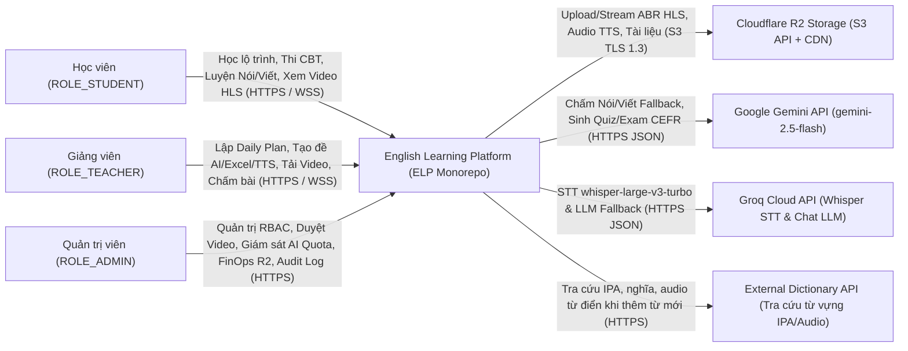
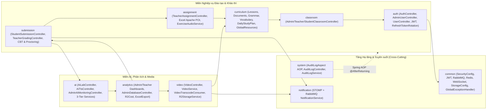
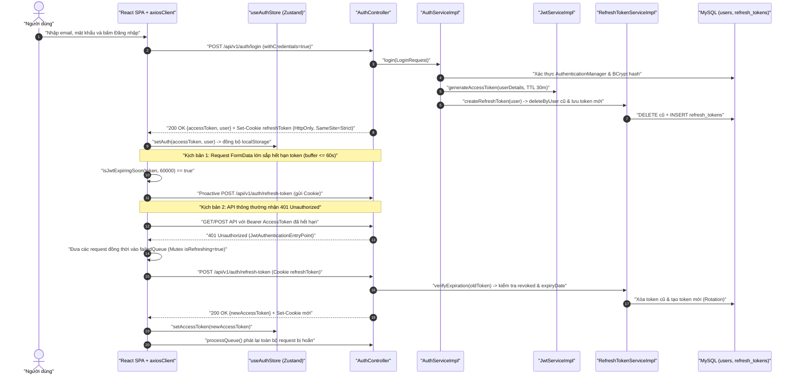
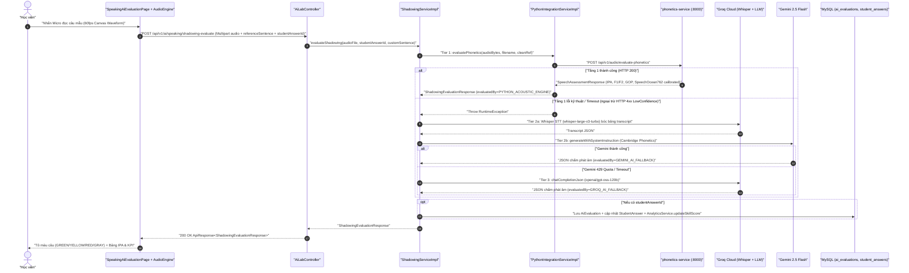
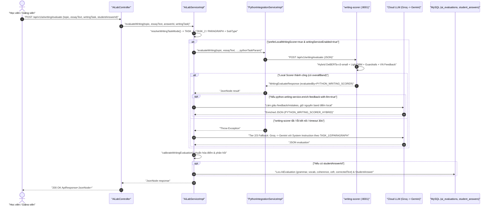
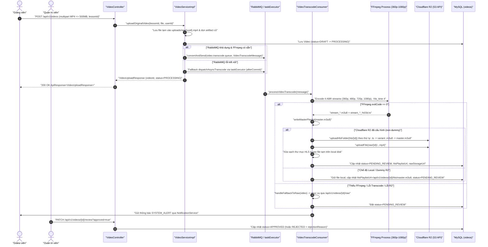

# 01. Kiến trúc Hệ thống Tổng thể (High-Level Design & C4 Model)

> Tài liệu này mô tả kiến trúc cấp cao (HLD), mô hình C4 (Context, Container, Component), ma trận giao tiếp liên dịch vụ và biểu đồ tuần tự (Sequence Diagrams) cho 5 luồng nghiệp vụ cốt lõi của nền tảng **English Learning Platform (ELP)**.

---

## 1. Phong cách Kiến trúc: Modular Monolith + Stateless AI Microservices

ELP áp dụng kiến trúc lai (**Hybrid Architecture**) kết hợp ưu điểm toàn vẹn giao dịch của **Modular Monolith** trên JVM với khả năng xử lý tính toán Deep Learning / DSP chuyên sâu của **2 Stateless Python AI Microservices**:

1. **Core Backend — Modular Monolith (`Spring Boot 3.2.5 / Java 17`):**
   - Toàn bộ nghiệp vụ kinh doanh, giao dịch cơ sở dữ liệu ACID, bảo mật JWT/RBAC, định tuyến WebSocket STOMP/Binary, xử lý hàng đợi RabbitMQ và điều phối Cloud API nằm trong một khối triển khai duy nhất (`englishlearning.jar`).
   - Mã nguồn được phân chia thành **11 domain packages** độc lập với kiến trúc phân tầng chuẩn hóa `Controller -> Service Interface -> Service Impl -> Repository -> Entity`, giao tiếp liên mô-đun thông qua Service Interfaces và DTOs.
2. **2 AI Microservices Không Trạng Thái (`Python FastAPI`):**
   - **`phonetics-service` (Port `8000`):** Nạp sẵn **Wav2Vec 2.0 XLS-R-53** (`facebook/wav2vec2-xlsr-53-espeak-cv-ft`), **Praat-Parselmouth** (C++ formant engine) và **Kokoro-82M Neural TTS**. Không kết nối cơ sở dữ liệu; giải phóng bộ nhớ audio ngay sau khi suy luận.
   - **`writing-scorer` (Port `8001`):** Nạp mô hình **`hybrid`** (`microsoft/deberta-v3-small` + TF-IDF/LightGBM + SVD Feedback Bank), chấm điểm luận IELTS (`TASK_1`, `TASK_2`, `PARAGRAPH`) hoàn toàn không trạng thái và ngoại tuyến.
3. **Frontend SPA (`React 19.2.8 / Vite 8.3 / TypeScript 6`):**
   - Phục vụ qua **Nginx** trong production (port `3000 -> 80`), đảm nhiệm reverse proxy `/api/` và `/ws`, stream trực tiếp `/uploads/` qua `sendfile` ở tầng kernel và chạy code-splitting theo 3 phân hệ vai trò (`Student`, `Teacher`, `Admin`).

| Tiêu chí kỹ thuật | Frontend SPA (`frontend/`) | Core Backend (`src/`) | AI Phonetics & TTS (`phonetics-service/`) | AI Writing Scorer (`writing-scorer/`) |
| :--- | :--- | :--- | :--- | :--- |
| **Runtime & Stack** | React 19.2.8, Vite 8.3, TypeScript 6, Zustand 5, TanStack Query 5, Nginx Alpine | Java 17, Spring Boot 3.2.5, Spring Security 6, JPA/Hibernate, HikariCP | Python 3.12 (3.10 Docker), FastAPI, PyTorch, Transformers, Parselmouth, Kokoro | Python, FastAPI, PyTorch 2.7, Transformers (`DeBERTa-v3-small`), LightGBM 4.7 |
| **Cổng mặc định** | `5173` (Dev) / `3000` (Docker Nginx `:80`) | `8080` | `8000` | `8001` |
| **Trách nhiệm chính** | UI/UX, Web Audio PCM/Waveform 60fps, HLS.js playback, CBT Proctoring, Excel import | Auth/RBAC, CRUD giáo trình, CBT engine, Quota/FinOps, Video ABR transcoding, AI orchestration | Forced Alignment Wav2Vec2, Formant F1/F2, Calibration SpeechOcean762, Kokoro-82M TTS | Chấm điểm 4 tiêu chí IELTS Writing (`TASK_1`, `TASK_2`, `PARAGRAPH`) + Guardrails |
| **Trạng thái (State)** | Client state (Zustand + localStorage CBT draft) | Stateful (MySQL 8.0 + Redis + R2 + Local temp disk) | Stateless (chỉ cache model weights tại `/app/cache`) | Stateless (chỉ nạp model tại `models/` lúc startup) |
| **Chiến lược Scale** | CDN / Nginx static replication | Horizontal scaling (sau khi Redis hóa state của `AiMonitoringServiceImpl`) | Scale độc lập theo CPU/GPU cho tác vụ audio/TTS | Scale độc lập theo GPU/CPU cho tác vụ NLP |

---

## 2. Sơ đồ C4 Level 1: Ngữ cảnh Hệ thống (System Context)



---

## 3. Sơ đồ C4 Level 2: Kiến trúc Container (Container Diagram)

```mermaid
flowchart TD
    Browser["Trình duyệt Người dùng (Desktop / Mobile SPA)"]

    subgraph Edge["Frontend & Reverse Proxy Container"]
        Nginx["Nginx Web Server (:3000 -> :80) & React 19 SPA"]
    end

    subgraph Core["Backend Core Container"]
        Spring["Spring Boot 3.2.5 Modular Monolith (:8080)"]
        FFmpeg["Tiến trình con FFmpeg (ABR HLS 360p-1080p)"]
    end

    subgraph AI["Python AI Microservices"]
        Phonetics["phonetics-service FastAPI (:8000) - Wav2Vec2 + Praat + Kokoro-82M"]
        Writing["writing-scorer FastAPI (:8001) - Hybrid DeBERTa-v3 + LightGBM"]
    end

    subgraph DataInfra["Persistence, Cache & Broker"]
        MySQL[("MySQL 8.0 (:3306 / :3307) - 32 Tables")]
        Redis[("Redis Cache (:6379) - TTL 60m & Audio Cache")]
        RabbitMQ["RabbitMQ Broker (:5672) - AMQP 0-9-1"]
        UploadsVol[("Shared Volume backend_uploads")]
    end

    subgraph External["Dịch vụ Cloud Ngoại vi"]
        R2["Cloudflare R2 Object Storage"]
        Gemini["Google Gemini 2.5 Flash"]
        Groq["Groq Cloud (Whisper + LLM)"]
    end

    Browser -->|"HTTPS (SPA, REST, Multipart) & WSS (/ws, /ws/audio)"| Nginx
    Nginx -->|"Serve static /assets & kernel sendfile /uploads"| UploadsVol
    Nginx -->|"Reverse Proxy /api/ & /ws -> :8080"| Spring

    Spring -->|"JDBC / HikariCP (max 30)"| MySQL
    Spring -->|"RedisTemplate / StringRedisTemplate"| Redis
    Spring -->|"AMQP Publish/Consume (video.transcode.queue, notification.queue)"| RabbitMQ
    Spring -->|"ProcessBuilder CLI"| FFmpeg
    Spring <-->|"Ghi/đọc file tạm & fallback media"| UploadsVol

    Spring -->|"HTTP Multipart /evaluate-phonetics & JSON /tts"| Phonetics
    Spring -->|"HTTP JSON /api/v1/writing/evaluate"| Writing

    Spring -->|"AWS SDK S3 v2.25.35 (Put/Get/Head/Delete/List)"| R2
    Spring -->|"REST Fallback & Exercise Gen"| Gemini
    Spring -->|"REST STT & LLM Fallback"| Groq
```



> **Lưu ý triển khai Docker vs Local:** Trong `docker-compose.yml` hiện tại, 4 container được định nghĩa sẵn là `mysql`, `phonetics-service`, `backend`, `frontend` trên bridge network `englishlearning-network`. Các dịch vụ `Redis`, `RabbitMQ` và `writing-scorer` được cấu hình kết nối qua biến môi trường (`REDIS_HOST`, `RABBITMQ_HOST`, `PYTHON_WRITING_SERVICE_URL`) — xem chi tiết tại [06-security-nfr-operations.md](./06-security-nfr-operations.md).

---

## 4. Sơ đồ C4 Level 3: Kiến trúc 11 Mô-đun Backend (`com.englishlearning`)

Hệ thống Backend tuân thủ kiến trúc **Modular Monolith** với 11 package phân tách theo ranh giới miền nghiệp vụ (Domain Boundaries):



### Bảng đặc tả 11 Domain Packages

| STT | Package (`com.englishlearning.*`) | Controllers | Services cốt lõi | Entities quản lý |
| :-: | :--- | :--- | :--- | :--- |
| 1 | `auth` | `AuthController`, `AdminUserController`, `UserController` | `AuthService`, `JwtService`, `RefreshTokenService`, `AdminUserService`, `UserDetailsServiceImpl` | `User`, `Role`, `RefreshToken`, `Student`, `Teacher` |
| 2 | `classroom` | `AdminClassroomController`, `TeacherClassroomController`, `StudentClassroomController` | `ClassroomService` | `Classroom`, `ClassStudent` |
| 3 | `curriculum` | `CurriculumController`, `DailyStudyPlanController`, `VocabularyController`, `AdminResourceController` | `CurriculumService`, `DailyStudyPlanService`, `DailyPlanService`, `VocabularyService`, `DictionaryLookupService`, `DocumentStorageService`, `GlobalResourceService`, `TtsAudioService`, `UserStreakService` | `Lesson`, `LessonDocument`, `GrammarTopic`, `VocabularyItem`, `StudentVocabularyProgress`, `DailyStudyPlan`, `DailyPlanItem`, `StudentDailyProgress`, `GlobalResource` |
| 4 | `assignment` | `TeacherAssignmentController` | `AssignmentService`, `ExerciseAudioService` | `Assignment`, `AssignmentQuestion`, `QuestionOption`, `ExerciseAudio` |
| 5 | `submission` | `StudentSubmissionController`, `TeacherGradingController` | `SubmissionService`, `CbtExerciseService`, `GradingEngineService` | `AssignmentAttempt`, `StudentAnswer` |
| 6 | `ai` | `AiLabController`, `AiTtsController`, `AdminAiMonitoringController` | `ShadowingService`, `ShadowingPracticeService`, `PythonIntegrationService`, `AiLabService`, `ExerciseGenerationService`, `GeminiClientService`, `GroqClientService`, `KokoroTtsClientService`, `WhisperPronunciationService`, `QuotaManagementService`, `AiMonitoringService`, `AiEvaluationService` + `AudioWebSocketHandler` | `AiEvaluation`, `AiGeneratedExercise`, `StudentAiQuota` |
| 7 | `analytics` | `AdminDashboardController`, `TeacherDashboardController`, `AnalyticsController`, `AdminDatabaseController` | `AdminDashboardService`, `AdminDatabaseService`, `AnalyticsService`, `ClassroomReportExcelExporter` | `LearningSession`, `StudentSkillProfile` |
| 8 | `video` | `VideoController` | `VideoService`, `HlsVideoConversionService`, `R2StorageService`, `R2UsageTracker`, `VideoTranscodeConsumer` | `Video`, `VideoWatchHistory` |
| 9 | `notification` | `NotificationController` | `NotificationService` | `Notification` |
| 10 | `system` | `AuditLogController` | `AuditLogService`, `AuditLogAspect` | `AuditLog` |
| 11 | `common` | *(Không có Controller)* | `RabbitMqEventPublisher`, `GlobalExceptionHandler`, `SecurityConfig`, `WebSocketConfig`, `AudioWebSocketConfig`, `RabbitMqConfig`, `RedisConfig`, `StorageConfig`, `AsyncConfig`, `AppProperties` | *(Shared DTOs & Exceptions)* |

---

## 5. Ma trận Giao tiếp Liên dịch vụ (Communication Matrix)

| Kênh giao tiếp | Thành phần nguồn -> Đích | Giao thức & Định dạng | Timeout / Độ tin cậy / Fallback |
| :--- | :--- | :--- | :--- |
| **Client <-> Backend API** | React SPA -> Nginx -> Spring Boot `:8080` | RESTful HTTP/1.1+JSON hoặc `multipart/form-data` (tối đa `500MB`) | Proactive JWT refresh cho FormData; 401 Promise Queue Mutex; Retry `1` trên TanStack Query |
| **Backend -> Phonetics AI** | `PythonIntegrationServiceImpl` -> `phonetics-service:8000` | HTTP Multipart (`audio` + `script`) / JSON (`/tts`, `/tts/dialogue`) | `connect-timeout=10s`, `read-timeout=120s` (override `application.properties`); lỗi -> Fallback Tier 2 (Whisper + Gemini) |
| **Backend -> Writing Scorer** | `PythonIntegrationServiceImpl` -> `writing-scorer:8001` | HTTP POST JSON (`application/json`) | `connect-timeout=5s`, `read-timeout=30s`; lỗi -> Fallback Cloud LLM (Groq -> Gemini) |
| **Backend <-> Message Broker** | `VideoServiceImpl` / `RabbitMqEventPublisher` -> RabbitMQ -> `VideoTranscodeConsumer` | AMQP 0-9-1 (`Jackson2JsonMessageConverter`) | Durable queues (`video.transcode.queue`, `notification.queue`), listener retry `3` lần (`2000ms` x `1.5`); nếu broker chết -> fallback `taskExecutor.execute()` chạy sau `afterCommit` |
| **Backend <-> Client Push** | `NotificationServiceImpl` -> React SPA qua `/ws` | STOMP over WebSocket / SockJS (`Authorization` / `token` trong `CONNECT`) | Kênh `/user/{userId}/queue/notifications`, `/topic/classroom.{id}`, `/topic/system-announcements`, `/topic/public`; Nginx `proxy_read_timeout 3600s` |
| **Realtime Audio Stream** | Browser -> `AudioWebSocketHandler` (`/ws/audio`) | Raw Binary WebSocket (Text JSON `{referenceText}` + Binary PCM) | Trả `ShadowingEvaluationResponse` JSON trực tiếp qua session mở |
| **Backend <-> Object Storage** | `R2StorageServiceImpl` -> Cloudflare R2 | S3 REST API qua AWS SDK v2 (`2.25.35`), TLS 1.3 | Path-style access enabled; rollback atomic khi upload HLS thất bại; fallback local `./uploads/` nếu chưa cấu hình R2 (`dummy`) |
| **Video/Audio Streaming** | Browser (`HLS.js` / `<video>`) -> `VideoController` / Nginx | HTTP/1.1 + `Range` (`206 Partial Content`, `416`) | Chunk đọc local `8MB`; stream R2 qua `R2ObjectStream`; Nginx `sendfile` trực tiếp cho `/uploads/` |

---

## 6. Biểu đồ Tuần tự cho 5 Luồng Nghiệp vụ Cốt lõi (Sequence Diagrams)

### 6.1. Luồng 1: Đăng nhập, Rotation Refresh Token & Tự làm mới Phiên (UC-AUTH-01)



### 6.2. Luồng 2: Đánh giá Phát âm Shadowing qua 3-Tier AI Fallback (UC-AI-01)



### 6.3. Luồng 3: Chấm điểm IELTS Writing Cục bộ (Local Hybrid ML + Fallback)



### 6.4. Luồng 4: Làm bài CBT, Giám sát Chống Gian lận & Chấm điểm Song song (UC-STU-01)

```mermaid
sequenceDiagram
    autonumber
    actor S as "Học viên"
    participant ExamUI as "ExamTakePage + useExamProctoring"
    participant SubCtrl as "StudentSubmissionController"
    participant SubSvc as "SubmissionServiceImpl"
    participant GrdSvc as "GradingEngineServiceImpl"
    participant NotifSvc as "NotificationServiceImpl"
    participant DB as "MySQL (assignment_attempts, student_answers)"
    actor T as "Giảng viên"

    S->>ExamUI: "Mở bài thi CBT -> vào chế độ Fullscreen"
    ExamUI->>SubCtrl: "POST /api/v1/student/assignments/{assignmentId}/start"
    SubCtrl->>SubSvc: "startAttempt(studentId, assignmentId)"
    SubSvc->>DB: "Tạo AssignmentAttempt (status=IN_PROGRESS, startedAt=now)"
    SubSvc-->>ExamUI: "AttemptResponse (attemptId, questions, timeLimit, strictFullscreen, maxViolations)"

    loop "Trong quá trình làm bài (lưu nháp LocalStorage mỗi vài giây)"
        alt "Phát hiện thoát Fullscreen / chuyển Tab (qua grace period 1.2s)"
            ExamUI->>SubCtrl: "POST /api/v1/student/assignments/attempts/{attemptId}/violation"
            SubCtrl->>SubSvc: "recordViolation(attemptId, eventType, reason, currentAnswers)"
            SubSvc->>DB: "Tăng violationCount, append violationLogJson"
            opt "Nếu violationCount >= maxViolations"
                SubSvc->>DB: "Đặt isCheatingFlagged=true & cưỡng chế nộp bài"
                SubSvc->>NotifSvc: "Gửi CHEATING_ALERT tới Giảng viên qua STOMP /queue/notifications"
                NotifSvc-->>T: "Real-time Cheating Alert"
            end
        end
    end

    S->>ExamUI: "Nhấn Nộp bài (hoặc hết giờ tự nộp)"
    ExamUI->>SubCtrl: "POST /api/v1/student/assignments/{assignmentId}/attempts/{attemptId}/submit"
    SubCtrl->>SubSvc: "submitAttempt(studentId, attemptId, SubmissionRequest)"
    SubSvc->>GrdSvc: "evaluateSubmission(questions, answers)"
    GrdSvc-->>SubSvc: "GradingResult (chấm ngay MCQ/T-F/Fill-Blank/Matching; đánh dấu ESSAY/AUDIO_RESPONSE)"
    SubSvc->>DB: "Lưu StudentAnswer, totalScore, status (COMPLETED hoặc SUBMITTED/GRADING)"
    opt "Nếu có giảng viên phụ trách"
        SubSvc->>NotifSvc: "Bắn thông báo SUBMISSION_RECEIVED"
    end
    SubSvc-->>ExamUI: "200 OK AttemptResponse"
    ExamUI-->>S: "Hiển thị điểm khách quan / Trạng thái chờ chấm AI hoặc Giảng viên"
```

### 6.5. Luồng 5: Tải lên Video, Chuyển mã ABR HLS 4 Mức & Kiểm duyệt Phát hành (UC-SYS-01)


