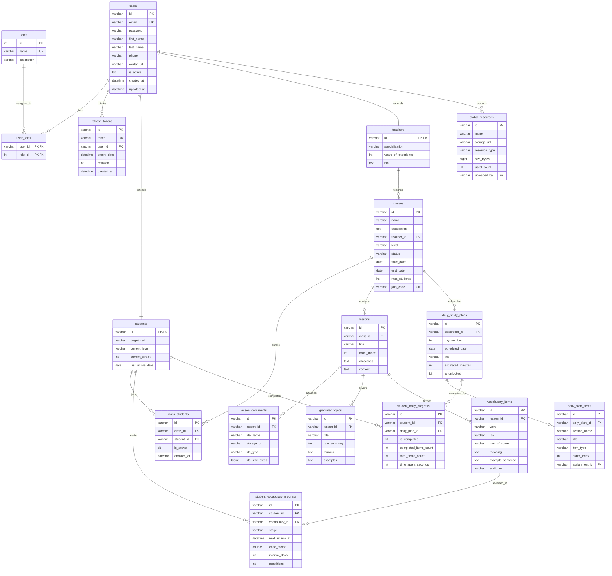
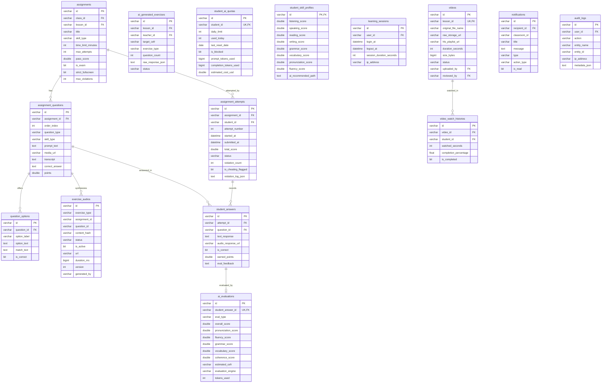

# 02. Thiết kế Dữ liệu & Cơ sở Dữ liệu (Data Architecture & ERD)

> Tài liệu này đặc tả kiến trúc lưu trữ quan hệ trên **MySQL 8.0**, sơ đồ quan hệ thực thể (**ERD 32 bảng**), từ điển dữ liệu chi tiết theo 5 cụm nghiệp vụ, danh mục **15 Domain Enums**, chiến lược Index, cơ chế khóa bi quan (`PESSIMISTIC_WRITE`) và quy trình xóa phân tầng (`Cascade Purge`).

---

## 1. Chiến lược Lưu trữ & Cấu hình Vận hành CSDL

### 1.1. Công nghệ & Thông số Connection Pool

| Tham số | Giá trị thực tế (`application.properties` / `pom.xml`) | Mục đích thiết kế |
| :--- | :--- | :--- |
| **DBMS Engine** | MySQL `8.0` (`mysql:8.0` Docker, `MySQLDialect`) | Hỗ trợ giao dịch ACID, row-level locking (`SELECT ... FOR UPDATE`), UTF-8mb4. |
| **JDBC Driver** | `com.mysql.cj.jdbc.Driver` (`mysql-connector-j`) | Khai báo thêm PostgreSQL driver trong `pom.xml` để sẵn sàng chuyển đổi khi cần. |
| **Chiến lược Khóa chính** | UUID lưu dạng `VARCHAR(36)` (`hibernate.type.preferred_uuid_jdbc_type=VARCHAR`); bảng `roles` dùng `INT AUTO_INCREMENT` | Sinh ID phía ứng dụng (`GenerationType.UUID`), tránh lộ quy mô bản ghi tuần tự và xung đột khi hợp nhất dữ liệu. |
| **Shared Primary Key (`@MapsId`)** | `students.id -> users.id`, `teachers.id -> users.id`, `student_skill_profiles.id -> students.id` | Tối ưu quan hệ 1-1: không tạo cột PK dư thừa, join trực tiếp trên khóa chính. |
| **HikariCP Pool** | `maximum-pool-size=30`, `minimum-idle=10`, `idle-timeout=30000ms`, `max-lifetime=1800000ms`, `connection-timeout=20000ms` | Đảm bảo độ trễ thấp khi tải đồng thời cao; giữ 10 kết nối ấm thường trực. |
| **Schema Management** | `spring.jpa.hibernate.ddl-auto=update`, `spring.flyway.enabled=false` | Thuận tiện phát triển nhanh; cần chuyển sang Flyway migration ở môi trường Production (xem Risk Register [06-security-nfr-operations.md](./06-security-nfr-operations.md)). |

### 1.2. Tổ chức 32 Bảng theo 5 Cụm Nghiệp vụ

Cơ sở dữ liệu bao gồm **31 JPA Entities** và **1 bảng liên kết nhiều-nhiều (`user_roles`)**, tổng cộng **32 bảng quan hệ**:

1. **Cụm 1 — Identity, RBAC & Session (`7 bảng`):** `users`, `roles`, `user_roles`, `refresh_tokens`, `students`, `teachers`, `audit_logs`.
2. **Cụm 2 — Classroom, Curriculum & Daily Roadmap (`11 bảng`):** `classes`, `class_students`, `lessons`, `lesson_documents`, `grammar_topics`, `vocabulary_items`, `student_vocabulary_progress`, `daily_study_plans`, `daily_plan_items`, `student_daily_progress`, `global_resources`.
3. **Cụm 3 — Assessment, CBT & Proctoring (`6 bảng`):** `assignments`, `assignment_questions`, `question_options`, `exercise_audios`, `assignment_attempts`, `student_answers`.
4. **Cụm 4 — AI Evaluation, Quota & Analytics (`5 bảng`):** `ai_evaluations`, `ai_generated_exercises`, `student_ai_quotas`, `student_skill_profiles`, `learning_sessions`.
5. **Cụm 5 — Video HLS & Notification (`3 bảng`):** `videos`, `video_watch_histories`, `notifications`.

---

## 2. Sơ đồ Quan hệ Thực thể (ERD — 32 Bảng)

Để đảm bảo dễ đọc và không chồng chéo dây liên kết, sơ đồ ERD toàn diện được chia thành 2 phân mảnh liên kết nhau qua các thực thể cầu nối (`students`, `classes`, `lessons`, `assignments`, `users`).

### 2.1. ERD Phần A — Identity, Classroom, Curriculum & Daily Study Plan

### 2.2. ERD Phần B — Assessment, CBT Submission, AI, Video & Operations

---

## 3. Từ điển Dữ liệu Chi tiết (Data Dictionary — 32 Bảng)

### 3.1. Cụm 1: Identity, RBAC, Session & Audit (`7 bảng`)

| Bảng | Cột | Kiểu dữ liệu (MySQL) | Khóa & Ràng buộc | Diễn giải nghiệp vụ |
| :--- | :--- | :--- | :--- | :--- |
| **`users`** | `id` | `VARCHAR(36)` | **PK**, NOT NULL, UUID | Định danh duy nhất tài khoản người dùng |
| | `email` | `VARCHAR(255)` | **UK**, NOT NULL | Email đăng nhập hệ thống (duy nhất) |
| | `password` | `VARCHAR(255)` | NOT NULL | Mật khẩu băm BCrypt (ẩn khỏi JSON qua `WRITE_ONLY`) |
| | `first_name`, `last_name` | `VARCHAR(100)` | NULLABLE | Họ và tên người dùng |
| | `phone`, `avatar_url` | `VARCHAR(20)` / `VARCHAR(500)` | NULLABLE | Số điện thoại và URL ảnh đại diện |
| | `is_active` | `BIT(1)` / `BOOLEAN` | NOT NULL, DEFAULT `true` | Trạng thái khóa/mở khóa tài khoản |
| | `created_at`, `updated_at` | `DATETIME(6)` | NOT NULL | Dấu thời gian tạo và cập nhật |
| **`roles`** | `id` | `INT` | **PK**, `AUTO_INCREMENT` | Mã vai trò |
| | `name` | `VARCHAR(50)` | **UK**, NOT NULL (`RoleName`) | `ROLE_ADMIN`, `ROLE_TEACHER`, `ROLE_STUDENT` |
| | `description` | `VARCHAR(255)` | NULLABLE | Mô tả vai trò |
| **`user_roles`** | `user_id` | `VARCHAR(36)` | **PK, FK** -> `users(id)` | Khóa ngoại tới người dùng |
| | `role_id` | `INT` | **PK, FK** -> `roles(id)` | Khóa ngoại tới vai trò |
| **`refresh_tokens`** | `id` | `VARCHAR(36)` | **PK**, UUID | Định danh bản ghi token làm mới |
| | `token` | `VARCHAR(500)` | **UK**, NOT NULL | Chuỗi UUID kép của Refresh Token |
| | `user_id` | `VARCHAR(36)` | **FK** -> `users(id)`, NOT NULL | Chủ sở hữu token |
| | `expiry_date` | `DATETIME(6)` | NOT NULL | Thời điểm hết hạn |
| | `revoked` | `BIT(1)` | NOT NULL, DEFAULT `false` | Cờ thu hồi khi logout |
| | `created_at` | `DATETIME(6)` | NOT NULL | Thời điểm phát hành |
| **`students`** | `id` | `VARCHAR(36)` | **PK, FK** -> `users(id)` (`@MapsId`) | Khóa chính dùng chung `users.id` |
| | `target_cefr`, `current_level` | `VARCHAR(10)` | NULLABLE | Mục tiêu CEFR (`B2`) và trình độ lớp hiện tại (`A1`...) |
| | `current_streak` | `INT` | DEFAULT `0` | Số ngày **có bài tập** (`DailyStudyPlan` chứa `assignment`) được hoàn thành 100% đúng hạn liên tiếp hiện tại; tính trực tiếp từ `daily_study_plans` + `daily_plan_items` + `assignment_attempts` và đồng bộ snapshot khi hoàn thành bài (ngày không có bài tập hoặc plan rỗng 0 assignment tự động bỏ qua, không làm mất chuỗi) |
| | `last_active_date` | `DATE` | NULLABLE | Ngày có bài tập được hoàn thành 100% gần nhất (`scheduled_date`) |
| **`teachers`** | `id` | `VARCHAR(36)` | **PK, FK** -> `users(id)` (`@MapsId`) | Khóa chính dùng chung `users.id` |
| | `specialization` | `VARCHAR(255)` | NULLABLE | Chuyên môn giảng dạy |
| | `years_of_experience` | `INT` | NULLABLE | Số năm kinh nghiệm |
| | `bio` | `TEXT` | NULLABLE | Tiểu sử giảng viên |
| **`audit_logs`** | `id` | `VARCHAR(36)` | **PK**, UUID | Định danh bản ghi kiểm toán |
| | `user_id` | `VARCHAR(36)` | **FK** -> `users(id)`, NULLABLE | Người thực hiện thao tác |
| | `action` | `VARCHAR(100)` | NOT NULL | Hành động (`CREATE`, `UPDATE`, `DELETE`, `ASSIGN`, `ENROLL`, ...) |
| | `entity_name`, `entity_id` | `VARCHAR(100)` / `VARCHAR(255)` | NULLABLE | Tên và ID thực thể bị tác động |
| | `ip_address` | `VARCHAR(45)` | NULLABLE | Địa chỉ IP client (`X-Forwarded-For` / `RemoteAddr`) |
| | `metadata_json` | `TEXT` | NULLABLE | Ngữ cảnh bổ sung dạng JSON |
| | `created_at` | `DATETIME(6)` | NOT NULL, `updatable=false` | Thời điểm phát sinh (bất biến) |

### 3.2. Cụm 2: Classroom, Curriculum, Vocabulary & Daily Study Plan (`11 bảng`)

| Bảng | Cột chính | Kiểu dữ liệu | Khóa & Ràng buộc | Diễn giải nghiệp vụ |
| :--- | :--- | :--- | :--- | :--- |
| **`classes`** | `id`, `name`, `description`, `teacher_id`, `level`, `status`, `start_date`, `end_date`, `max_students`, `join_code`, `created_at`, `updated_at` | `VARCHAR(36)` PK, `VARCHAR(150)`, `TEXT`, `VARCHAR(36)` FK (`teachers.id`), `ClassLevel`, `ClassStatus`, `DATE`, `INT`, `VARCHAR(20)` UK | **PK** `id`, **UK** `join_code`, **FK** `teacher_id` | Quản lý lớp học, trình độ (`BEGINNER..C2, IELTS_PREP, TOEIC_PREP`) và trạng thái mở lớp |
| **`class_students`** | `id`, `class_id`, `student_id`, `is_active`, `enrolled_at` | `VARCHAR(36)` PK/FK, `BIT(1)`, `DATETIME(6)` | **FK** `class_id -> classes(id)`, `student_id -> students(id)` | Bảng ghi danh học viên vào lớp học |
| **`lessons`** | `id`, `class_id`, `title`, `order_index`, `objectives`, `content`, `created_at`, `updated_at` | `VARCHAR(36)` PK/FK, `VARCHAR(200)`, `INT`, `TEXT` | **FK** `class_id -> classes(id)` | Bài học theo thứ tự trong lớp; liên kết 1-1 `videos` và 1-N tài liệu/từ vựng/ngữ pháp |
| **`lesson_documents`** | `id`, `lesson_id`, `file_name`, `storage_url`, `file_type`, `file_size_bytes`, `created_at` | `VARCHAR(36)`, `VARCHAR(255)`, `VARCHAR(1000)`, `DocumentType`, `BIGINT` | **FK** `lesson_id -> lessons(id)` | Tài liệu đính kèm bài học (`PDF`, `DOCX`, `PPTX`, `IMAGE`, `AUDIO`) |
| **`grammar_topics`** | `id`, `lesson_id`, `title`, `rule_summary`, `formula`, `examples` | `VARCHAR(36)`, `VARCHAR(150)`, `TEXT` | **FK** `lesson_id -> lessons(id)` | Chủ điểm ngữ pháp thuộc bài học |
| **`vocabulary_items`** | `id`, `lesson_id`, `word`, `ipa`, `part_of_speech`, `meaning`, `example_sentence`, `audio_url`, `image_url`, `synonyms`, `antonyms` | `VARCHAR(36)`, `VARCHAR(100)`, `VARCHAR(50)`, `TEXT`, `VARCHAR(1000)` | **FK** `lesson_id -> lessons(id)` | Kho từ vựng bài học (tự động tra IPA & audio qua `DictionaryLookupService`) |
| **`student_vocabulary_progress`** | `id`, `student_id`, `vocabulary_id`, `stage`, `next_review_at`, `ease_factor`, `interval_days`, `repetitions` | `VARCHAR(36)`, `SpacedRepetitionStage`, `DATETIME(6)`, `DOUBLE` (`2.5`), `INT` (`0`) | **FK** `student_id`, `vocabulary_id` | Bảng dữ liệu chuẩn thuật toán lặp lại ngắt quãng **SM-2** (`NEW`, `LEARNING`, `REVIEWING`, `MASTERED`) |
| **`daily_study_plans`** | `id`, `classroom_id`, `day_number`, `scheduled_date`, `title`, `estimated_minutes`, `is_unlocked` | `VARCHAR(36)`, `INT`, `DATE`, `VARCHAR(255)`, `BIT(1)` (`false`) | **FK** `classroom_id -> classes(id)` | Kế hoạch lộ trình học theo từng ngày (`Day 1..N`) của lớp |
| **`daily_plan_items`** | `id`, `daily_plan_id`, `section_name`, `title`, `item_type`, `order_index`, `assignment_id` | `VARCHAR(36)`, `VARCHAR(255)`, `INT` | **FK** `daily_plan_id`, `assignment_id -> assignments(id)` | Các đầu mục/bài tập nằm trong một ngày học |
| **`student_daily_progress`** | `id`, `student_id`, `daily_plan_id`, `is_completed`, `completed_items_count`, `total_items_count`, `completed_at`, `time_spent_seconds` | `VARCHAR(36)`, `BIT(1)`, `INT`, `DATETIME(6)` | **FK** `student_id`, `daily_plan_id` | Tiến độ hoàn thành lộ trình ngày của từng học viên |
| **`global_resources`** | `id`, `name`, `storage_url`, `resource_type`, `size_bytes`, `used_count`, `uploaded_by`, `created_at` | `VARCHAR(36)`, `VARCHAR(255)`, `VARCHAR(1000)`, `ResourceType`, `BIGINT`, `INT` | **FK** `uploaded_by -> users(id)` | Thư viện học liệu toàn cục dùng chung (`DOC`, `VIDEO`, `EXAM`) |

### 3.3. Cụm 3: Assessment, CBT & Proctoring (`6 bảng`)

| Bảng | Cột chính | Kiểu dữ liệu | Khóa & Ràng buộc | Diễn giải nghiệp vụ |
| :--- | :--- | :--- | :--- | :--- |
| **`assignments`** | `id`, `class_id`, `lesson_id`, `title`, `description`, `skill_type`, `time_limit_minutes`, `max_attempts`, `pass_score`, `max_allowed_error_percent`, `due_date`, `audio_url`, `listening_script`, `is_exam`, `exam_skills`, `strict_fullscreen`, `max_violations`, `created_at`, `updated_at` | `VARCHAR(36)`, `VARCHAR(200)`, `SkillType`, `INT`, `DOUBLE`, `VARCHAR(1000)`, `TEXT`, `BIT(1)` | **FK** `class_id` (NOT NULL), `lesson_id` (NULLABLE) | Đề bài tập hoặc kỳ thi CBT (`is_exam=true`), hỗ trợ cấu hình proctoring (`strict_fullscreen`, `max_violations`) và audio nghe |
| **`assignment_questions`** | `id`, `assignment_id`, `order_index`, `question_type`, `skill_type`, `prompt_text`, `media_url`, `transcript`, `correct_answer`, `explanation`, `points` | `VARCHAR(36)`, `INT`, `QuestionType`, `SkillType`, `TEXT`, `VARCHAR(1000)`, `DOUBLE` | **FK** `assignment_id -> assignments(id)` | Câu hỏi chi tiết theo 6 dạng (`MULTIPLE_CHOICE`, `TRUE_FALSE`, `FILL_IN_BLANK`, `MATCHING`, `AUDIO_RESPONSE`, `ESSAY`) |
| **`question_options`** | `id`, `question_id`, `option_label`, `option_text`, `match_text`, `is_correct` | `VARCHAR(36)`, `VARCHAR(10)`, `TEXT`, `BIT(1)` | **FK** `question_id -> assignment_questions(id)` | Phương án trắc nghiệm A/B/C/D hoặc cặp ghép nối `match_text` cho dạng `MATCHING` |
| **`exercise_audios`** | `id`, `exercise_type`, `assignment_id`, `question_id`, `content_hash`, `voice_config`, `status`, `is_active`, `url`, `duration_ms`, `segments`, `version`, `generated_by`, `error_message`, `created_at`, `updated_at` | `VARCHAR(36)`, `ExerciseAudioType`, `VARCHAR(64)`, `AudioGenerationStatus`, `BIT(1)`, `LONGTEXT`, `INT`, `AudioGeneratedBy` | **Indexes:** `(question_id, is_active)`, `(assignment_id)`, `(content_hash)` | Quản lý vòng đời & phiên bản âm thanh Kokoro-82M TTS, chống trùng bằng SHA-256 `content_hash` |
| **`assignment_attempts`** | `id`, `assignment_id`, `student_id`, `attempt_number`, `started_at`, `submitted_at`, `duration_seconds`, `total_score`, `status`, `teacher_feedback`, `violation_count`, `is_cheating_flagged`, `cheating_reason`, `violation_log_json`, `created_at` | `VARCHAR(36)`, `INT`, `DATETIME(6)`, `DOUBLE`, `AttemptStatus`, `BIT(1)`, `VARCHAR(500)`, `TEXT` | **FK** `assignment_id`, `student_id`; **3 Indexes** | Lượt làm bài CBT, điểm tổng, feedback giảng viên và nhật ký vi phạm proctoring |
| **`student_answers`** | `id`, `attempt_id`, `question_id`, `text_response`, `audio_response_url`, `is_correct`, `earned_points`, `eval_feedback` | `VARCHAR(36)`, `TEXT`, `VARCHAR(1000)`, `BIT(1)`, `DOUBLE` | **FK** `attempt_id`, `question_id` | Câu trả lời từng câu (văn bản/ID option/audio URL) và điểm từng câu |

### 3.4. Cụm 4: AI Evaluation, FinOps Quota & Analytics (`5 bảng`)

| Bảng | Cột chính | Kiểu dữ liệu | Khóa & Ràng buộc | Diễn giải nghiệp vụ |
| :--- | :--- | :--- | :--- | :--- |
| **`ai_evaluations`** | `id`, `student_answer_id`, `eval_type`, `overall_score`, `pronunciation_score`, `fluency_score`, `grammar_score`, `vocabulary_score`, `coherence_score`, `estimated_cefr`, `stt_transcript`, `corrected_text`, `mistakes_json`, `suggestions_json`, `tokens_used`, `evaluation_engine`, `created_at` | `VARCHAR(36)`, `AiEvaluationType`, `DOUBLE`, `VARCHAR(10)`, `TEXT`, `INT`, `VARCHAR(50)` | **UK, FK** `student_answer_id -> student_answers(id)` | Kết quả chấm Speaking/Shadowing/Writing từ Python Engine hoặc Cloud Fallback |
| **`ai_generated_exercises`** | `id`, `lesson_id`, `teacher_id`, `target_cefr`, `exercise_type`, `question_count`, `raw_response_json`, `status`, `created_at`, `updated_at` | `VARCHAR(36)`, `VARCHAR(10)`, `VARCHAR(30)`, `INT`, `TEXT`, `GenerationStatus` | **FK** `lesson_id`, `teacher_id -> teachers(id)` | Bản nháp đề thi/bài tập do AI sinh trước khi giảng viên duyệt xuất bản |
| **`student_ai_quotas`** | `id`, `student_id`, `daily_limit`, `used_today`, `last_reset_date`, `is_blocked`, `prompt_tokens_used`, `completion_tokens_used`, `estimated_cost_usd` | `VARCHAR(36)`, `INT` (`20`), `DATE`, `BIT(1)`, `BIGINT`, `DOUBLE` | **UK, FK** `student_id -> students(id)` | Theo dõi hạn mức AI hàng ngày, token tiêu thụ & chi phí USD (khóa `PESSIMISTIC_WRITE`) |
| **`student_skill_profiles`** | `id`, `listening_score`, `speaking_score`, `reading_score`, `writing_score`, `grammar_score`, `vocabulary_score`, `pronunciation_score`, `fluency_score`, `ai_recommended_path`, `updated_at` | `VARCHAR(36)` PK/FK, `DOUBLE` (`0.0`), `TEXT` | **PK, FK** -> `students(id)` (`@MapsId`) | Hồ sơ radar 8 chỉ số kỹ năng của học viên |
| **`learning_sessions`** | `id`, `user_id`, `login_at`, `logout_at`, `session_duration_seconds`, `ip_address`, `user_agent` | `VARCHAR(36)`, `DATETIME(6)`, `INT`, `VARCHAR(45)`, `TEXT` | **FK** `user_id -> users(id)` | Theo dõi thời lượng phiên học tập của người dùng |

### 3.5. Cụm 5: Video HLS & Notification (`3 bảng`)

| Bảng | Cột chính | Kiểu dữ liệu | Khóa & Ràng buộc | Diễn giải nghiệp vụ |
| :--- | :--- | :--- | :--- | :--- |
| **`videos`** | `id`, `lesson_id`, `original_file_name`, `raw_storage_url`, `hls_playlist_url`, `thumbnail_url`, `duration_seconds`, `size_bytes`, `status`, `rejection_reason`, `uploaded_by`, `reviewed_by`, `created_at`, `updated_at` | `VARCHAR(36)`, `VARCHAR(255)`, `VARCHAR(1000)`, `INT`, `BIGINT`, `VideoStatus`, `TEXT` | **UK, FK** `lesson_id -> lessons(id)`, **FK** `uploaded_by`, `reviewed_by -> users(id)` | Metadata video bài giảng, URL playlist HLS (`master.m3u8`), trạng thái chuyển mã và kiểm duyệt |
| **`video_watch_histories`** | `id`, `video_id`, `student_id`, `watched_seconds`, `completion_percentage`, `is_completed`, `created_at`, `updated_at` | `VARCHAR(36)`, `INT`, `FLOAT`, `BIT(1)` | **FK** `video_id`, `student_id` | Lịch sử xem video và phần trăm hoàn thành của học viên |
| **`notifications`** | `id`, `recipient_id`, `classroom_id`, `title`, `message`, `type`, `target_url`, `action_type`, `reference_id`, `is_read`, `created_at` | `VARCHAR(36)`, `VARCHAR(200)`, `TEXT`, `NotificationType`, `VARCHAR(500)`, `BIT(1)` | **FK** `recipient_id -> users(id)` (NULLABLE); **2 Indexes** | Thông báo cá nhân, theo lớp (`classroom_id`) hoặc toàn hệ thống (`recipient_id IS NULL`) |

### 3.6. Quy ước Thang điểm Chuẩn (Canonical Scoring Scale Contract)

Toàn hệ thống tách bạch rạch ròi 3 miền thang điểm để tránh sai số khi tổng hợp, lưu trữ và hiển thị:

| Thang điểm | Phạm vi áp dụng (`bảng / DTO / UI`) | Quy tắc lưu trữ & chuẩn hóa |
| :--- | :--- | :--- |
| **`0.0 – 10.0`** (Thang 10 chuẩn) | `assignment_attempts.total_score`, `assignments.pass_score`, `student_answers.earned_points` (câu tự luận/nói), `TeacherGradeRequest.finalScore`, `AttemptResponse.score`, và mọi chỉ số ĐTB lớp/học viên/báo cáo hiển thị dạng `/ 10` | Mọi điểm nộp bài và điểm giáo viên chấm được kiểm tra `[0.0, 10.0]` ở DTO & Service, làm tròn 1 chữ số thập phân |
| **`0.0 – 9.0`** (IELTS Band) / **`0.0 – 10.0`** (Shadowing) | `ai_evaluations.overall_score` và 5 cột điểm thành phần (`pronunciation_score`, `fluency_score`, `grammar_score`, `vocabulary_score`, `coherence_score`) | Writing/Speaking Band (`<= 9.0`) được quy đổi sang thang 10 khi cộng vào `total_score` hoặc khi GV nhấn áp dụng theo công thức `(band / 9.0) * 10.0`; Shadowing (`phonetics-service`) chia `10.0` trước khi lưu `ai_evaluations` |
| **`0.0 – 100.0`** (Thang phần trăm kỹ năng) | `student_skill_profiles` (radar 8 chỉ số kỹ năng) và raw response `ShadowingEvaluationResponse.overallScore` từ `phonetics-service` | Khi hiển thị trên Dashboard thang 10 (`TeacherDashboardController`) phải chia `10.0` qua `ScoreScaleUtils.normalizeToScale10OrZero` |

**Cơ chế phòng vệ 2 lớp & di trú dữ liệu cũ (`legacy 0–100`):**
- **Tầng khởi động DB (`ScoreScaleMigrationRunner`)**: Chạy lũy đẳng (*idempotent*) khi khởi động backend, tự động chia `10.0` (giới hạn `<= 10.0`) các bản ghi legacy có điểm `> 10.0` ở `assignment_attempts.total_score`, `assignments.pass_score`, `student_answers.earned_points` (`ESSAY`/`AUDIO_RESPONSE`) và `ai_evaluations`.
- **Tầng Backend (`ScoreScaleUtils`) & Frontend (`scoreScale.ts`)**: Chuẩn hóa các giá trị legacy `> 10.0` bằng `raw / 10.0` và kẹp cận `[0.0, 10.0]` trước khi tính trung bình hoặc render UI.

---

## 4. Danh mục 15 Domain Enums

| Enum | Các giá trị thực tế trong mã nguồn | Bảng sử dụng |
| :--- | :--- | :--- |
| `RoleName` | `ROLE_ADMIN`, `ROLE_TEACHER`, `ROLE_STUDENT` | `roles` |
| `ClassLevel` | `BEGINNER`, `A1`, `A2`, `B1`, `B2`, `C1`, `C2`, `IELTS_PREP`, `TOEIC_PREP` | `classes` |
| `ClassStatus` | `PLANNING`, `OPEN`, `IN_PROGRESS`, `COMPLETED`, `CANCELLED` | `classes` |
| `DocumentType` | `PDF`, `DOCX`, `PPTX`, `IMAGE`, `AUDIO` | `lesson_documents` |
| `GlobalResource.ResourceType` | `DOC`, `VIDEO`, `EXAM` | `global_resources` |
| `SpacedRepetitionStage` | `NEW`, `LEARNING`, `REVIEWING`, `MASTERED` | `student_vocabulary_progress` |
| `SkillType` | `LISTENING`, `SPEAKING`, `READING`, `WRITING`, `VOCABULARY`, `GRAMMAR` | `assignments`, `assignment_questions` |
| `QuestionType` | `MULTIPLE_CHOICE`, `TRUE_FALSE`, `FILL_IN_BLANK`, `MATCHING`, `AUDIO_RESPONSE`, `ESSAY` | `assignment_questions` |
| `ExerciseAudioType` | `SHADOWING`, `LISTENING` | `exercise_audios` |
| `AudioGenerationStatus` | `PENDING`, `PROCESSING`, `READY`, `FAILED`, `BROKEN` | `exercise_audios` |
| `AudioGeneratedBy` | `SYSTEM`, `TEACHER`, `STUDENT_REPAIR` | `exercise_audios` |
| `AttemptStatus` | `IN_PROGRESS`, `SUBMITTED`, `GRADING`, `COMPLETED`, `TIMED_OUT` | `assignment_attempts` |
| `AiEvaluationType` | `SPEAKING`, `WRITING`, `COMPREHENSIVE_PROFILE` | `ai_evaluations` |
| `GenerationStatus` | `PENDING_GENERATION`, `READY_FOR_REVIEW`, `PUBLISHED`, `REJECTED` | `ai_generated_exercises` |
| `VideoStatus` | `DRAFT`, `PROCESSING`, `PENDING_REVIEW`, `READY`, `APPROVED`, `REJECTED`, `ARCHIVED` | `videos` |
| `NotificationType` | `NEW_ASSIGNMENT`, `DEADLINE_REMINDER`, `VIDEO_APPROVED`, `VIDEO_REJECTED`, `NEW_GRADE`, `ANNOUNCEMENT`, `SYSTEM_ALERT` | `notifications` |

*(Ghi chú: 15 enum đứng độc lập trong package và 1 inner enum `GlobalResource.ResourceType`.)*

---

## 5. Chiến lược Đánh chỉ mục, Toàn vẹn & Quản trị Vòng đời Dữ liệu

### 5.1. Chỉ mục Tối ưu Truy vấn (Declared Indexes)

Ngoài các Unique/FK Index tự động sinh bởi InnoDB (`users.email`, `classes.join_code`, `refresh_tokens.token`, `ai_evaluations.student_answer_id`, `student_ai_quotas.student_id`, `videos.lesson_id`), các bảng tần suất đọc cao được gắn Composite Indexes tường minh:

| Bảng | Tên Index | Cột đánh chỉ mục | Truy vấn phục vụ |
| :--- | :--- | :--- | :--- |
| `exercise_audios` | `idx_ex_audio_question` | `(question_id, is_active)` | Tra cứu nhanh audio bản active của câu hỏi |
| `exercise_audios` | `idx_ex_audio_assignment` | `(assignment_id)` | Xóa/thu thập URL audio khi xóa bài tập hoặc purge lớp |
| `exercise_audios` | `idx_ex_audio_hash` | `(content_hash)` | Đối soát cache hit theo SHA-256 nội dung + cấu hình giọng đọc |
| `assignment_attempts` | `idx_attempt_student_status` | `(student_id, status)` | Lọc bài đang làm / đã hoàn thành của học viên |
| `assignment_attempts` | `idx_attempt_assignment_student` | `(assignment_id, student_id)` | Đếm số lượt đã làm (`max_attempts`) và lịch sử làm bài |
| `assignment_attempts` | `idx_attempt_assignment_submitted` | `(assignment_id, submitted_at)` | Sắp xếp danh sách bài nộp tại bàn chấm giảng viên |
| `notifications` | `idx_notif_recipient_read_created` | `(recipient_id, is_read, created_at)` | Tải danh sách thông báo chưa đọc mới nhất trên Notification Bell |
| `notifications` | `idx_notif_classroom` | `(classroom_id)` | Truy xuất thông báo theo lớp học |

### 5.2. Chống Tranh chấp Đồng thời & N+1 Query

1. **Khóa bi quan (Pessimistic Locking) trên AI Quota (`QuotaManagementServiceImpl`):**
   - Hàm `deductAiQuota(studentId, count)` gọi `studentAiQuotaRepository.findByStudentIdWithLock(studentId)` sử dụng `@Lock(LockModeType.PESSIMISTIC_WRITE)` (`SELECT ... FOR UPDATE`).
   - Ngăn chặn Race Condition khi học viên gửi nhiều request chấm AI song song nhằm vượt quá `daily_limit` (mặc định `20`).
2. **Batch Fetching chống N+1 (`DailyStudyPlanServiceImpl`):**
   - `getStudentDailyOverview()` tải một lần toàn bộ `DailyPlanItem` theo `classroomId` bằng `findByClassroomIdWithDailyPlanAndAssignment(classroomId)` và danh sách `completedAssignmentIds` của học viên, nhóm vào `Map<UUID, List<DailyPlanItem>>` trong bộ nhớ thay vì truy vấn lặp cho từng ngày.

### 5.3. Quản trị Vòng đời & Xóa Phân tầng (`Cascade Purge` & Scheduled Cleanup)

1. **Dọn Refresh Token hết hạn (`RefreshTokenServiceImpl`):**
   - Cron `@Scheduled(cron = "0 0 2 * * ?")` chạy lúc 02:00 sáng hàng ngày xóa các bản ghi hết hạn hoặc `revoked = true` trong `refresh_tokens`.
2. **Dọn dữ liệu bài nộp & Xóa vĩnh viễn Lớp học (`AdminDatabaseServiceImpl`):**
   - `purgeClassroomSubmissions(classroomId, force)`: Xóa tuần tự theo thứ tự phụ thuộc khóa ngoại `ai_evaluations -> student_answers -> assignment_attempts -> student_daily_progress -> video_watch_histories -> student_vocabulary_progress`, đồng thời thu thập và xóa file ghi âm học viên (`audio_response_url`) trên Cloudflare R2.
   - `deleteClassroom(classroomId)`: Thực hiện purge toàn bộ bài nộp, sau đó xóa `daily_plan_items`, `daily_study_plans`, `assignments` (kèm `exercise_audios`, `question_options`, `assignment_questions`), `lessons` (kèm `videos` & HLS prefix trên R2, `lesson_documents`, `vocabulary_items`, `grammar_topics`), `class_students`, và cuối cùng xóa `classes`, kèm bảo vệ `protectedUrls` để không xóa nhầm tài nguyên dùng chung từ `global_resources`.
   - Mọi thao tác xóa đều được ghi lại bất biến vào `audit_logs`.
