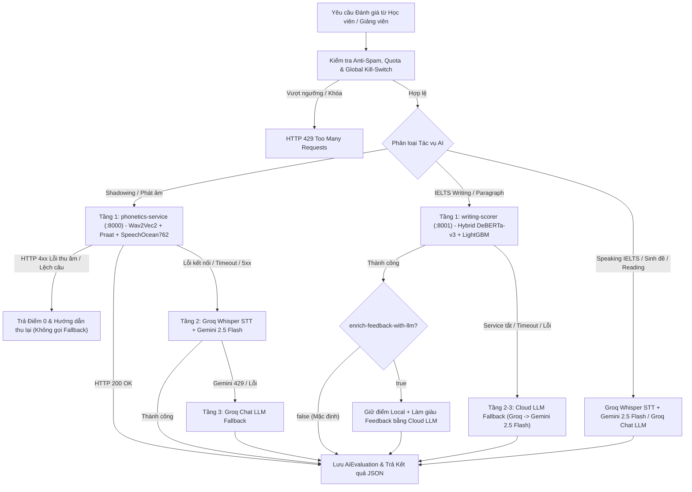
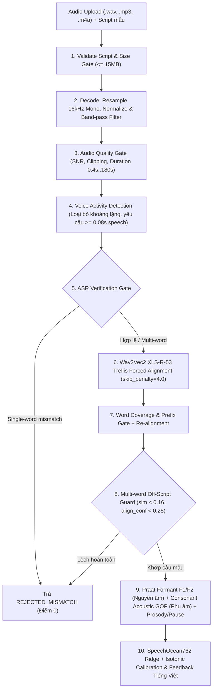
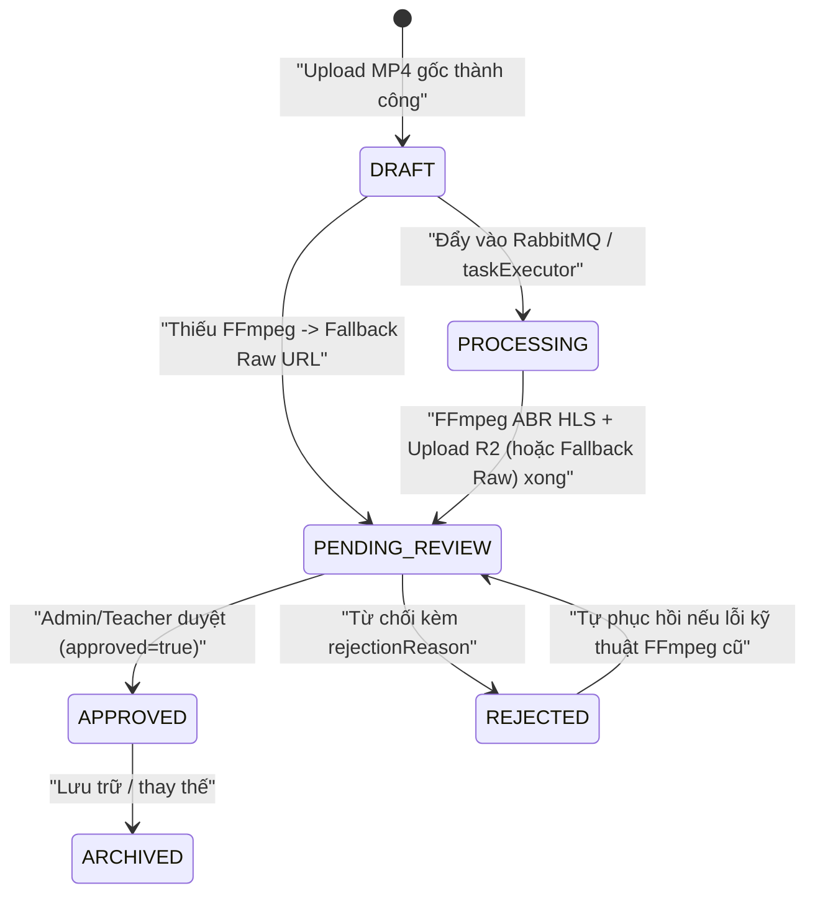

# 04. Thiết kế Các Pipeline AI, Ngữ âm, Chấm luận & Media ABR HLS

> Tài liệu này trình bày chi tiết kiến trúc và thuật toán của **4 pipeline kỹ thuật lõi**: (1) Điều phối AI Đàn hồi Đa tầng & FinOps Governance, (2) Động cơ Ngữ âm Âm học (`phonetics-service`), (3) Động cơ Chấm luận IELTS Cục bộ (`writing-scorer`), và (4) Tổng hợp Kokoro-82M Neural TTS + Chuyển mã Video ABR HLS trên Cloudflare R2.

---

## 1. Kiến trúc AI Đàn hồi Đa tầng & Quản trị Chi phí (FinOps)

### 1.1. Chiến lược Local-First kết hợp Multi-Tier Fallback

Để triệt tiêu điểm lỗi đơn lẻ (Single Point of Failure), giảm độ trễ mạng và tối ưu chi phí Cloud API, mọi tác vụ AI nặng đều tuân theo nguyên tắc **Local-First, Cloud-Fallback**:

### 1.2. Đặc tả Mô hình & Thông số Cấu hình Thực tế

| Nhánh AI | Tầng | Động cơ / Mô hình cấu hình (`AppProperties` / Code) | Nhiệm vụ chính | Định danh `evaluationEngine` |
| :--- | :---: | :--- | :--- | :--- |
| **Shadowing** | 1 | `phonetics-service` (`wav2vec2-xlsr-53-espeak-cv-ft` + Praat C++) | Gióng hàng âm vị, Formant F1/F2, GOP, hiệu chuẩn SpeechOcean762 | `PYTHON_ACOUSTIC_ENGINE` |
| **Shadowing** | 2 | Groq `whisper-large-v3-turbo` + Google `gemini-2.5-flash` | Bóc băng transcript + chấm câu/âm vị theo Cambridge rubric | `GEMINI_AI_FALLBACK` |
| **Shadowing** | 3 | Groq Chat (`openai/gpt-oss-120b` trong `AppProperties`) | Fallback khẩn cấp khi Gemini chạm 429 hoặc mất kết nối | `GROQ_AI_FALLBACK` |
| **Writing** | 1 | `writing-scorer` (`hybrid`: `microsoft/deberta-v3-small` + LightGBM) | Chấm `TASK_1`, `TASK_2`, `PARAGRAPH` ngoại tuyến + feedback tiếng Việt | `PYTHON_WRITING_SCORER` (hoặc `PYTHON_WRITING_SCORER_HYBRID`) |
| **Writing** | 2–3 | Groq Chat -> Google `gemini-2.5-flash` | Chấm theo prompt rubric chuyên biệt từng dạng bài khi local offline | `GROQ_*` / `GEMINI_*` |
| **Speaking IELTS** | 1–2 | Groq `whisper-large-v3-turbo` (hoặc Gemini Audio STT) + LLM | Đánh giá IELTS Part 1 / Part 2 / Part 3 theo Band Descriptors | Lưu trong `ai_evaluations` |
| **Sinh đề CEFR** | 1 | `gemini-2.5-flash` (`ExerciseGenerationServiceImpl`) | Sinh câu hỏi `MULTIPLE_CHOICE` và từ vựng `MATCHING` | `ai_generated_exercises` |

### 1.3. Kiểm soát Hạn mức, Anti-Spam & FinOps (`QuotaManagementServiceImpl` & `AiMonitoringServiceImpl`)

1. **Khóa bi quan trên Hạn mức Học viên (`QuotaManagementServiceImpl`):**
   - Mỗi học viên có bản ghi `student_ai_quotas` với `dailyLimit` mặc định `20` lượt/ngày và tự động reset theo `LocalDate.now()`.
   - Truy vấn bằng `findByStudentIdWithLock(studentId)` (`@Lock(LockModeType.PESSIMISTIC_WRITE)`) ngăn chặn tấn công đồng thời (concurrency race condition) vượt quota.
2. **Sliding Window Rate Limiter & Kill-Switch (`AiMonitoringServiceImpl`):**
   - Bộ đếm cửa sổ trượt 60 giây trong bộ nhớ (`ConcurrentHashMap<String, Deque<Instant>>`): giới hạn **Học viên tối đa 3 lần/phút**, **Giảng viên tối đa 5 lần/phút** (kèm hạn mức mặc định **50 lượt/ngày** cho giảng viên).
   - **Global Kill-Switch:** Quản trị viên có thể bật/tắt ngay lập tức qua `POST /api/v1/admin/ai-monitoring/kill-switch/toggle`, trả `429 Too Many Requests` cho toàn bộ yêu cầu AI khi cần bảo trì hoặc khống chế chi phí khẩn cấp.
3. **Mô hình Hạch toán Chi phí (`AiMonitoringServiceImpl`):**
   - Đơn giá theo dõi Gemini: `\$0.075` / 1M input tokens, `\$0.30` / 1M output tokens.
   - Đơn giá theo dõi Groq: `\$0.59` / 1M input tokens, `\$0.79` / 1M output tokens (hiển thị trên dashboard dưới nhóm engine `Google Gemini 2.5 Flash` và `Groq LLaMA 3.3 70B` — xem mục Risk Register [06-security-nfr-operations.md](./06-security-nfr-operations.md) về đồng bộ nhãn model).

---

## 2. Pipeline Ngữ âm Âm học Chuyên sâu (`phonetics-service` — Port `8000`)

### 2.1. Quy trình Xử lý 10 Bước trên Endpoint `/api/v1/audio/evaluate-phonetics`

### 2.2. Thông số Kỹ thuật & Thuật toán Lõi (`config.py`, `routes.py`)

- **Mô hình CTC Acoustic:** `facebook/wav2vec2-xlsr-53-espeak-cv-ft` chạy ở tần số chuẩn `SAMPLE_RATE = 16000` Hz; chuyển đổi chữ sang chuỗi âm vị IPA bằng `g2p_en` + `espeakng-loader`.
- **Phát hiện Từ bị Bỏ sót (Missing Word Detection):** Sử dụng Viterbi Trellis với phạt nhảy cóc `WORD_SKIP_PENALTY_PER_TOKEN = 4.0` nats kết hợp kiểm tra đa tín hiệu: độ phủ vùng nói VAD (`SPEECH_TRIM_MARGIN_SEC = 0.25s`), tỷ lệ năng lượng RMS so với trung vị bài nói (`MISSING_WORD_MIN_ENERGY_RATIO = 0.06`), và xác suất hậu nghiệm CTC thô (`MISSING_WORD_MIN_RAW_POSTERIOR = 0.02`). Từ bị đọc thiếu được gán `MISSING`, từ thiếu bằng chứng quá 50% âm vị (`PARTIAL_WORD_MIN_EVIDENCE_RATIO = 0.5`) bị đánh dấu `PARTIAL`.
- **Phân tích Nguyên âm & Phụ âm (`formant_service.py`):** Trích xuất cao độ F0 xác định profile nam/nữ (`detect_gender`), đo tần số cộng hưởng F1 (độ mở hàm) và F2 (độ trước/sau của lưỡi) bằng thư viện C++ **Praat-Parselmouth**, đối chiếu với phân phối tham chiếu `reference_profiles/vowels.json` và đánh giá phụ âm bằng mật độ phổ năng lượng cao / âm bật cuối từ.
- **Trọng số & Ngưỡng Đạt (`config.py`, `calibration.json`):**
  - Trọng số điểm tổng hợp thô: `PRONUNCIATION_WEIGHT = 0.60`, `FLUENCY_WEIGHT = 0.28`, `SPEED_WEIGHT = 0.12`.
  - Tốc độ nói tối ưu: `3.5 – 5.5` âm tiết/giây (`SPEED_TARGET_MIN`, `SPEED_TARGET_MAX`); phân loại ngắt nghỉ `PAUSE_THRESHOLD_MS = 250ms` và ngập ngừng dài `LONG_PAUSE_THRESHOLD_MS = 1000ms`.
  - Ngưỡng Đạt chuẩn (`isPassed = true`): `overallScore >= 80.0` VÀ `pronunciationScore >= 75.0` VÀ `completeness >= 80%`.

### 2.3. Kết quả Hiệu chuẩn Thực nghiệm (`calibration.json` v1.1.0)

Hệ thống không chấm cảm tính mà sử dụng mô hình hồi quy **Ridge Regression kết hợp Isotonic Calibration (25 knots)** huấn luyện theo **5-fold Speaker GroupKFold** trên toàn bộ bộ dữ liệu chuẩn quốc tế **SpeechOcean762** (`4,989` câu nói, `250` người nói) và kiểm chứng neo trên tập **LibriSpeech** (`659` câu nói người bản xứ/chuẩn):

| Chỉ số hiệu chuẩn (`calibration.json` v1.1.0) | Pearson `r` | Spearman `rho` | MAE | RMSE | Mean True / Pred |
| :--- | :---: | :---: | :---: | :---: | :---: |
| **Pronunciation (22 features)** | `0.7223` | `0.6535` | `8.288` | `11.123` | `76.65` / `76.69` |
| **Fluency (21 features)** | `0.7992` | `0.7436` | `6.772` | `8.773` | `77.97` / `77.98` |
| **Prosody (21 features)** | `0.7860` | `0.7352` | `6.931` | `8.892` | `74.74` / `74.75` |
| **Overall (11 meta-features)** | `0.7743` | `0.7146` | `7.524` | `10.026` | `72.35` / `72.40` |

- **Kiểm chứng neo LibriSpeech (`n=659`):** Điểm tổng hiệu chuẩn trung bình đạt `85.74 ± 2.95`, điểm phát âm trung bình `90.73`, **tỷ lệ đạt chuẩn (≥80) là `97.0%`**.

---

## 3. Pipeline Chấm điểm IELTS & Academic Writing (`writing-scorer` — Port `8001`)

### 3.1. Kiến trúc Mô hình Hybrid & Chẩn đoán Sư phạm (`service.py`, `infer.py`)

`writing-scorer` xử lý chấm điểm bài viết hoàn toàn ngoại tuyến với 3 nhánh tự động nhận diện theo ngữ cảnh (`TASK_1`, `TASK_2`, `PARAGRAPH` và các `writingSubType` như `TASK1_DATA`, `TASK1_PROCESS`, `TASK1_MAP`, `TASK2_OPINION`, `PARAGRAPH_EMAIL`, ...):

1. **Tầng Dự đoán Band Điểm (`best_manifest.json` -> `hybrid`):**
   - Kết hợp **Multitask Transformer (`microsoft/deberta-v3-small`)** (hidden size `768`, `max_length=512`, Adafactor, `lr=3.5e-5`, 4 epochs, peak VRAM `3,173 MB`) với **Baseline TF-IDF + LightGBM** trên các đặc trưng bề mặt ngôn ngữ (word/sentence/paragraph counts, TTR, RTTR, discourse markers, prompt cosine similarity).
   - Áp dụng **Affine Calibrators** riêng cho `overall_band` và 4 tiêu chí (`task_response`, `coherence_cohesion`, `lexical_resource`, `grammatical_range`).
2. **Tầng Bảo vệ Rubric (Guardrails & Task-Specific Calibrations):**
   - **Ngưỡng độ dài riêng biệt:** `TASK_1` chuẩn `>=150` từ; `TASK_2` chuẩn `>=250` từ (cảnh báo `<220`, `<120`, `<50` từ); `PARAGRAPH` chuẩn `40–150` từ (tự động trích xuất dải từ mục tiêu từ đề bài để không áp sai luật 250 từ của Task 2).
   - **Phát hiện Lạc đề / Lặp từ / Tiếng Việt:** Kiểm tra TF-IDF cosine similarity + prompt coverage (`is_off_topic`), lặp 3-gram (`repeated_trigram_ratio > 0.32`), chép lại đề bài (`is_parroting`), hoặc viết tiếng Việt có dấu (`_VIETNAMESE_DIACRITIC_RE`) để giới hạn trần band điểm (`<= 4.0`).
3. **Tầng Sinh Phản hồi Sư phạm Tiếng Việt & Truy xuất Feedback Bank:**
   - Truy xuất mẹo giám khảo từ `feedback_bank.joblib` (SVD embeddings, cosine similarity `>= 0.60` + Jaccard overlap với đề bài).
   - Phát hiện lỗi chính tả/ngữ pháp xác định (`_TYPO_CORRECTIONS`, mạo từ `a/an`, chủ-vị `there is + plural`, `one of the + singular`, đại từ `i`, dấu câu), tạo bản sửa bài mẫu `correctedText`, highlight nâng cấp câu theo từng tiêu chí và gợi ý từ vựng học thuật.

### 3.2. Kết quả Đánh giá Thực nghiệm (`evaluation_report.json`, `n=876`)

| Mô hình | Tập Validation (`n=876`) | Tập Test (`n=876`) |
| :--- | :--- | :--- |
| **`baseline` (TF-IDF + LightGBM)** | QWK `0.7287` · MAE `0.3195` · RMSE `0.4324` · Within ±0.5: `91.67%` | QWK `0.6726` · MAE `0.3357` · RMSE `0.4780` · Within ±0.5: `92.12%` |
| **`transformer` (`DeBERTa-v3-small`)** | QWK `0.8106` · MAE `0.2599` · RMSE `0.3784` · Within ±0.5: `96.69%` | QWK `0.7961` · MAE `0.2715` · RMSE `0.3985` · Within ±0.5: `95.66%` |
| **`hybrid` (Production Default)** | **QWK `0.8280` · MAE `0.2502` · RMSE `0.3603` · Pearson `0.8642` · Within ±0.5: `97.15%` · Within ±1.0: `99.54%`** | **QWK `0.7833` · MAE `0.2664` · RMSE `0.3910` · Pearson `0.8313` · Within ±0.5: `95.78%` · Within ±1.0: `98.74%`** |

*(Trên tập Test, mô hình `hybrid` đạt QWK từng tiêu chí phụ: Task Response `0.7041`, Coherence & Cohesion `0.7736`, Lexical Resource `0.8104`, Grammatical Range `0.8198`.)*

---

## 4. Pipeline Tổng hợp Giọng nói Kokoro-82M TTS & Self-Healing Audio

`ExerciseAudioServiceImpl` phối hợp với `phonetics-service` (`kokoro>=0.9.4`, 24kHz mono WAV) quản lý vòng đời âm thanh mẫu cho bài tập Listening & Shadowing:

1. **Hỗ trợ Đơn thoại & Hội thoại Đa giọng (`parseDialogueScript`):**
   - Tự động nhận diện kịch bản có từ 2 lượt nói trở lên (ví dụ `A: ... / B: ...`) để gọi `/tts/dialogue` (gán giọng US/UK nam/nữ khác nhau theo từng speaker, khoảng nghỉ `interTurnPauseMs = 450ms`, trả về `segments[]` có `startMs`/`endMs` phục vụ đồng bộ phụ đề).
   - Kịch bản đơn thoại gọi `/tts` với giọng mặc định `af_heart`.
2. **Chống trùng lặp SHA-256 & Cache Đa tầng:**
   - Sinh `contentHash = SHA-256("kokoro-v0.9.5|" + mode + "|" + text + "|" + voiceConfig)`. Nếu bản ghi active (`isActive=true`, `status=READY`) trùng `contentHash`, trả về ngay lập tức (Cache Hit).
   - Đồng bộ hóa cache vào Redis (`exercise_audio:{questionId}`, TTL `2 giờ`) và lưu tệp WAV vĩnh viễn lên Cloudflare R2 (hoặc local fallback).
3. **Khóa Đồng thời & Tự phục hồi (`STUDENT_REPAIR`):**
   - Sử dụng `questionLocks` (`ConcurrentHashMap<UUID, Object>`) ngăn stampede khi nhiều yêu cầu tạo audio cùng lúc cho một `questionId`.
   - Kiểm tra tính toàn vẹn âm thanh sau sinh (`validateGeneratedAudioFile`: kích thước `>= 1,000 bytes`, thời lượng `>= 300ms`) trước khi ghi đè nguyên tử (`deactivateOldAudios` + nâng `version`).
   - Khi audio bài tập gặp sự cố 404/lỗi phát ở trình duyệt, học viên thuộc lớp học đó có thể kích hoạt `POST /api/v1/ai/tts/questions/{questionId}/repair` để backend tái tạo audio ngay lập tức.

---

## 5. Pipeline Chuyển mã Video ABR HLS & Lưu trữ Cloudflare R2

### 5.1. Máy trạng thái Vòng đời Video (`VideoStatus`)

### 5.2. Bảng Thông số Adaptive Bitrate (ABR) Ladder (`VideoTranscodeConsumer`)

Khi nhận thông điệp từ `video.transcode.queue`, `VideoTranscodeConsumer` chạy FFmpeg (`libx264`, `-preset veryfast`, `-pix_fmt yuv420p`, `-g 48`, `-hls_time 4`, AAC audio) tạo đồng thời **4 luồng chất lượng**:

| Biến thể (Variant) | Độ phân giải | Video Bitrate | MaxRate / BufSize | Audio Bitrate (AAC) | File Playlist |
| :---: | :---: | :---: | :---: | :---: | :--- |
| **`360p`** | `640x360` | `800k` | `856k` / `1200k` | `96k` | `stream_360p.m3u8` |
| **`480p`** | `854x480` | `1400k` | `1498k` / `2100k` | `128k` | `stream_480p.m3u8` |
| **`720p`** | `1280x720` | `2800k` | `2996k` / `4200k` | `128k` | `stream_720p.m3u8` |
| **`1080p`** | `1920x1080` | `5000k` | `5350k` / `7500k` | `192k` | `stream_1080p.m3u8` |

- **Upload Nguyên tử & Dọn dẹp Ổ cứng:** `R2StorageServiceImpl.uploadHlsFolder()` sắp xếp tải toàn bộ các mảnh `.ts` trước, tiếp theo là các playlist con `stream_*.m3u8`, và cuối cùng mới upload `master.m3u8` để đảm bảo trình phát không bao giờ đọc phải playlist thiếu phân đoạn; nếu có lỗi bất kỳ tệp nào, toàn bộ key đã đẩy lên R2 trong phiên đó sẽ bị rollback (`cleanupUploadedKeys`). Sau khi lên R2 thành công, cả thư mục HLS cục bộ và file `.mp4` tạm được xóa khỏi local disk.
- **2 Lớp Graceful Degradation:** (1) Nếu RabbitMQ sập, `VideoServiceImpl` chuyển sang `taskExecutor` chạy sau `afterCommit`; (2) Nếu thiếu FFmpeg, lỗi tiến trình hoặc R2 ở chế độ dummy, `handleFallbackToRaw()` chuyển video về phát qua endpoint proxy `/api/v1/videos/{id}/raw` có hỗ trợ HTTP `Range`.

### 5.3. Quản trị Chi phí Cloudflare R2 FinOps (`AdminDatabaseServiceImpl` & `R2UsageTracker`)

- Hệ thống theo dõi `Class A ops` (PUT/LIST), `Class B ops` (GET/HEAD) qua `R2UsageTracker` và quét bucket thực tế (hoặc ước tính từ DB nếu chưa kết nối R2) để xuất báo cáo **`R2CostReportDto`**:
  - **Hạn mức miễn phí (Free Tier):** `10 GB` lưu trữ, `1,000,000` Class A ops/tháng, `10,000,000` Class B ops/tháng, `\$0` Egress fee.
  - **Đơn giá vượt ngưỡng:** `\$0.015 / GB` lưu trữ, `\$4.50 / 1M` Class A ops, `\$0.36 / 1M` Class B ops; quy đổi VND theo cấu hình `app.r2.usd-to-vnd-rate` (mặc định `25,400`) và đối chiếu ngân sách tháng `app.r2.monthly-budget-usd` (`\$20.0`).
