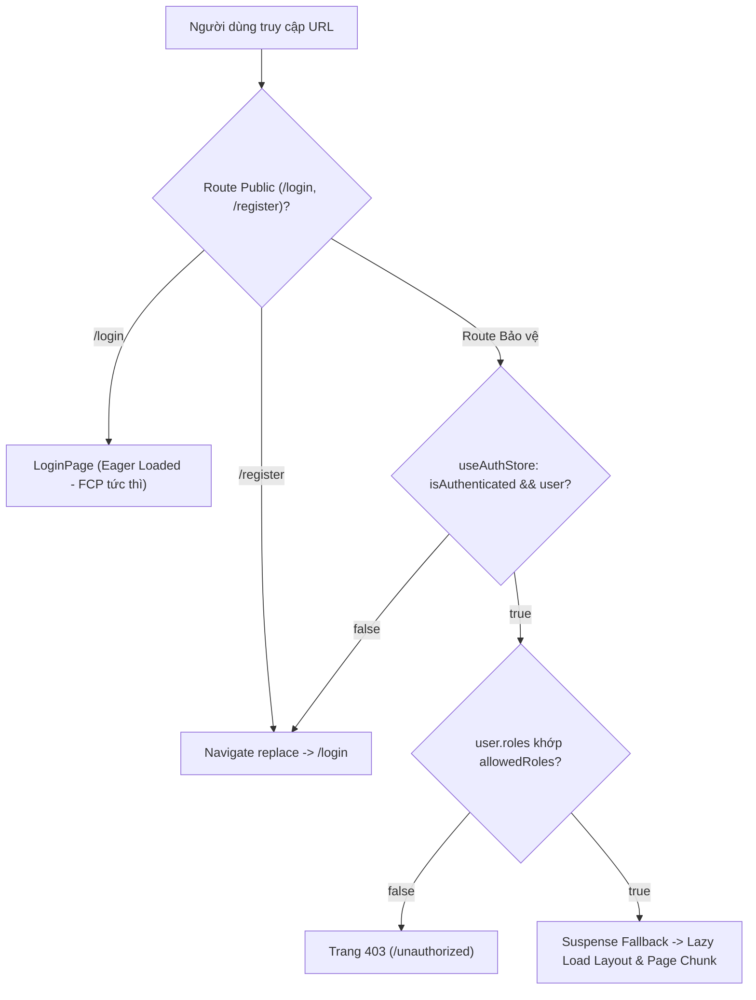
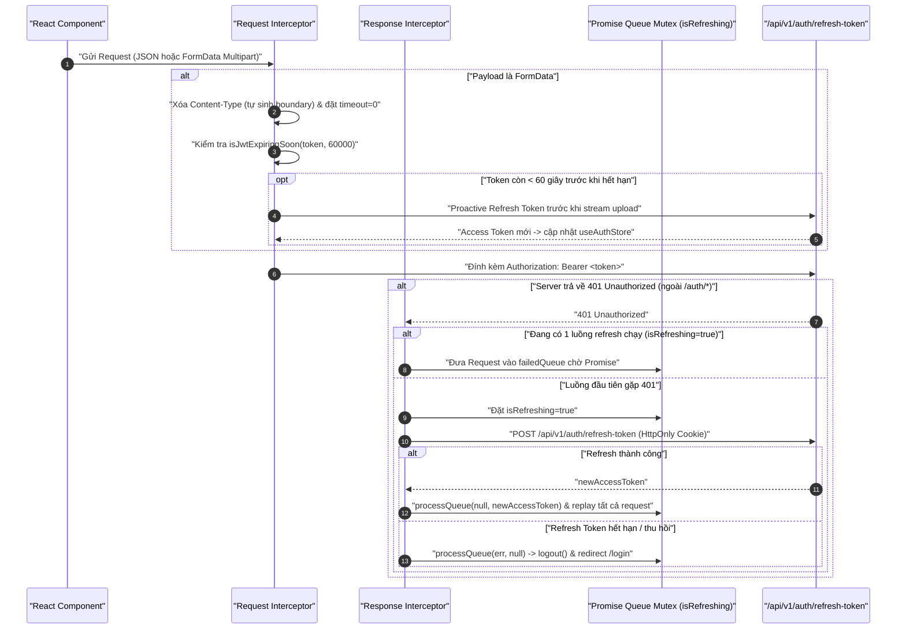

# 05. Kiến trúc Frontend SPA & Kỹ thuật Trải nghiệm Người dùng (Frontend Architecture)

> Tài liệu này đặc tả kiến trúc ứng dụng đơn trang (**React 19.2.8 SPA**), hệ thống định tuyến & code-splitting, chiến lược quản lý trạng thái (**TanStack Query + Zustand 5**), tầng giao tiếp HTTP tự phục hồi phiên (`axiosClient`), các engine tương tác chuyên sâu (Audio 60fps Canvas, ABR Video Player, CBT Proctoring, Excel Import) và quy chuẩn **Design System `impeccable`**.

---

## 1. Tech Stack & Tổ chức Mã nguồn (`frontend/src/`)

| Thành phần | Thư viện & Phiên bản (`package.json`) | Vai trò kiến trúc |
| :--- | :--- | :--- |
| **Core Framework** | `react ^19.2.8`, `react-dom ^19.2.8`, `typescript ~6.0.2`, `vite ^8.3.0` | Render UI hiệu năng cao, type safety nghiêm ngặt, đóng gói ESM nhanh |
| **Routing & Code Splitting** | `react-router-dom ^7.18.4` (`createBrowserRouter`) | Định tuyến 4 phân hệ, lazy-load chunk theo vai trò với `Suspense` |
| **Server State & Cache** | `@tanstack/react-query ^5.104.0` | Cache API (`staleTime: 5m`, `gcTime: 15m`, `retry: 1`, `refetchOnWindowFocus: false`) |
| **Client Global State** | `zustand ^5.0.15` (`subscribeWithSelector`) | Quản lý Auth (`useAuthStore`), Audio 60fps (`useAudioStore`), Shadowing (`usePracticeStore`) |
| **HTTP Client** | `axios ^1.20.0` | Intercept token, Proactive Pre-flight Refresh & 401 Promise Queue Mutex |
| **Media & Visualization** | `hls.js ^1.7.4`, `recharts ^3.10.1`, `xlsx ^0.18.5` | Phát ABR HLS, biểu đồ Radar/AI FinOps, đọc/xuất Excel đề thi phía Client |
| **Design & Styling** | `tailwindcss ^3.4.19`, `lucide-react ^1.49.0`, `tailwind-merge`, `clsx` | Thiết kế chuẩn `impeccable` hỗ trợ Light/Dark mode (`ThemeProvider`) |
| **Testing** | `vitest ^5.1.0`, `@testing-library/react ^16.3.3`, `jsdom` | 24 bộ kiểm thử unit & contract integration |

**Phân tầng thư mục theo Feature-Sliced Pattern:**
- `src/routes/`: Khai báo `router` và `ProtectedRoute`.
- `src/features/{auth,student,teacher,admin}/`: Tách biệt theo nghiệp vụ (`pages/`, `components/`, `hooks/`, `api/`, `types/`, `utils/`, `__tests__/`).
- `src/store/`: 3 Zustand stores toàn cục (`useAuthStore`, `useAudioStore`, `usePracticeStore`).
- `src/lib/`: `axiosClient.ts`.
- `src/components/ui/`: 12 Core UI primitives chuẩn hóa (`Button`, `Input`, `Textarea`, `Card`, `Badge`, `Modal`, `Tooltip`, `Dropdown`, `Tabs`, `Skeleton`, `EmptyState`, `AudioPlayer`).
- `src/components/layouts/` & `src/components/notification/`: `PublicLayout`, `StudentLayout`, `TeacherLayout`, `AdminLayout`, `NotificationBell`.

---

## 2. Bản đồ Định tuyến, Code-Splitting & Kiểm soát Truy cập (`routes/index.tsx`)

### 2.1. Luồng Điều hướng & Bảo vệ Tuyến (`ProtectedRoute`)

### 2.2. Danh mục Tuyến theo Phân hệ Vai trò

- **Public (`PublicLayout`, Eager):** `/login`, `/register` (redirect về `/login`), `/unauthorized` (trang thông báo 403), `*` (fallback về `/login`).
- **Student (`StudentLayout` — `ROLE_STUDENT`, 12 page routes lazy-loaded):**
  - `/student/courses` (`StudentCoursesPage`) · `/student/courses/:classId/lessons` (`ClassLessonsPage`) · `/student/courses/:classId/assignments` (`ClassAssignmentsPage`) · `/student/courses/:classId/daily-plan` (`DailyHomeworkPage`)
  - `/student/lessons/:lessonId` (`LessonDetailPage`) · `/student/assignments/:assignmentId/take` (`AssignmentTakePage`) · `/student/exams/:assignmentId/take` (`ExamTakePage`)
  - `/student/submissions`, `/student/speaking-ai`, `/student/submissions/:attemptId`, `/student/assignments/:assignmentId/submissions/:attemptId` (`SpeakingAiEvaluationPage`)
  - `/student/profile` (`StudentProfilePage`)
- **Teacher (`TeacherLayout` — `ROLE_TEACHER` hoặc `ROLE_ADMIN`, 13 route paths lazy-loaded):**
  - `/teacher/dashboard` (`TeacherDashboardPage`) · `/teacher/classrooms` (`TeacherClassroomsPage`) · `/teacher/classrooms/:classId` (`TeacherClassDetailPage`)
  - `/teacher/videos` (`TeacherVideosPage`) · `/teacher/lessons/:lessonId` & `/teacher/classrooms/:classId/lessons/:lessonId` (`TeacherLessonDetailPage`)
  - `/teacher/classrooms/:classId/students` (`TeacherClassStudentsPage`) · `/teacher/classrooms/:classId/plans` (`TeacherDailyPlanPage`)
  - `/teacher/classrooms/:classId/grading`, `/teacher/grading`, `/teacher/submissions` (`TeacherGradingPage`)
  - `/teacher/classrooms/:classId/exams` (`TeacherClassExamsPage`) · `/teacher/broadcast` (`SystemBroadcastPage`)
- **Admin (`AdminLayout` — `ROLE_ADMIN`, 14 page routes lazy-loaded):**
  - `/admin/dashboard` (`AdminDashboardPage`) · `/admin/teachers` (`TeacherManagementPage`) · `/admin/students` (`StudentManagementPage`) · `/admin/users` (`UserManagementPage`)
  - `/admin/classrooms` (`ClassroomManagementPage`) · `/admin/classrooms/:classId` (`ClassroomDetailPage`) · `/admin/lessons/:lessonId` (`AdminLessonDetailPage`)
  - `/admin/video-moderation` (`VideoModerationPage`) · `/admin/resource-library` (`ResourceLibraryPage`) · `/admin/broadcast` (`SystemBroadcastPage`)
  - `/admin/reports` (`AdminReportsPage`) · `/admin/audit-logs` (`AuditLogPage`) · `/admin/ai-monitoring` (`AiMonitoringPage`) · `/admin/database` (`AdminDatabaseStoragePage`)

---

## 3. Chiến lược Quản lý Trạng thái (State Management)

| Tầng State | Công cụ | Phạm vi & Dữ liệu lưu giữ | Nguyên tắc thiết kế |
| :--- | :--- | :--- | :--- |
| **Server State** | TanStack Query v5 (`App.tsx`) | Danh sách lớp, bài học, lộ trình ngày, bảng thống kê Admin/Teacher | `staleTime=5 phút`, `gcTime=15 phút`, `refetchOnWindowFocus=false`, `retry=1` |
| **Auth State** | Zustand `useAuthStore` | `accessToken`, `user`, `isAuthenticated` | Đọc/ghi an toàn `localStorage` có bẫy `try/catch` chống crash khi cache hỏng |
| **Audio Engine State** | Zustand `useAudioStore` (`subscribeWithSelector`) | `recordingState` (`idle\|recording\|recorded\|evaluating\|evaluated\|error`), `playbackSpeed`, `selectedVoice` (`af_heart`), `liveLearnerPeaks` (60 cột) | **Transient Subscription:** chỉ `DualWaveformVisualizer` subscribe trực tiếp `liveLearnerPeaks` để vẽ Canvas 60fps không gây re-render component cha |
| **Practice State** | Zustand `usePracticeStore` | `practiceMode` (`shadowing\|normal`), `targetSentence`, `selectedWordKey`, `evaluationResult`, `nativeStaticPeaks` | `buildDeterministicNativePeaks()` sinh sóng âm mẫu tất định (deterministic) ngay lập tức |
| **Exam Draft State** | `useAssignmentTakeSession` + `localStorage` | Câu trả lời tạm thời trong phiên CBT | Tự động lưu bản nháp cục bộ chống mất dữ liệu khi rớt mạng / reload trang |

---

## 4. Tầng Giao tiếp HTTP & Cơ chế Tự phục hồi Phiên (`axiosClient.ts`)

`axiosClient.ts` cài đặt `withCredentials: true`, header `ngrok-skip-browser-warning: true` và cơ chế làm mới JWT 2 lớp giúp loại bỏ tình trạng rớt kết nối giữa phiên thi hoặc upload video lớn:

---

## 5. Các Engine Tương tác Chuyên biệt phía Client

### 5.1. Audio Capture & Shadowing Studio (`useShadowingAudioEngine`)

- **Phát âm thanh mẫu thông minh:** Hỗ trợ cache URL TTS cục bộ (`ttsCacheRef`), lọc URL lỗi (`isInvalidSampleAudioUrl`), điều chỉnh tốc độ phát và kích hoạt luồng `repairNativeAudio()` nếu tệp âm thanh gốc lỗi 404.
- **Thu âm & Sóng âm 60fps không giật lag:** Dùng `MediaRecorder` kết hợp `AudioContext` + `AnalyserNode` đọc biên độ tần số qua `requestAnimationFrame`, đẩy mảng 60 cột `liveLearnerPeaks` vào `useAudioStore` để `DualWaveformVisualizer` vẽ trực tiếp lên `<canvas>`.
- **Hiển thị phản hồi 3 tầng:** `ShadowingTranscriptBoard` tô màu từng từ theo `WordHighlightToken` (`GREEN` / `YELLOW` / `RED` / `GRAY`), `KpiMetricGauge` hiển thị 5 chỉ số (`pronunciation`, `fluency`, `completeness`, `prosody`, `wordsPerMinute`), và `ShadowingFeedbackDrawer` giải phẫu chi tiết từng âm vị IPA và F1/F2.

### 5.2. Adaptive Bitrate Video Player & Error Recovery (`VideoPlayer.tsx`)

- Tự động phát hiện băng thông mạng qua `navigator.connection` (`mapSpeedToQuality`: `>=5 Mbps -> 1080p`, `>=2.5 -> 720p`, `>=1.0 -> 480p`, `<1.0 / 2G -> 360p`) hoặc cho phép người học chuyển thủ công (`auto`, `1080`, `720`, `480`, `360`) và tốc độ (`0.75x` – `2.0x`).
- Tích hợp `hls.js` với hỗ trợ tải lười (`lazyLoad`), đồng bộ tiến độ xem video lên server (`POST /api/v1/videos/{id}/progress`) và cơ chế tự phục hồi (`VideoPlayerRecovery`): tự động chuyển sang URL `raw` proxy nếu luồng HLS gặp lỗi fatal.

### 5.3. Giám sát Phòng thi CBT (`useExamProctoring`)

- Hỗ trợ chế độ `strictFullscreen`: yêu cầu trình duyệt vào `requestFullscreen()`, cài đặt `graceUntilRef` (`1200ms`) tránh ghi nhận nhầm ngay khoảnh khắc mở fullscreen và chống trùng sự kiện (`1500ms` debounce).
- Theo dõi chuyển tab / mất tiêu điểm (`visibilitychange`, `blur`) và thoát fullscreen; mỗi vi phạm gọi `POST /api/v1/student/assignments/attempts/{attemptId}/violation` kèm snapshot câu trả lời hiện tại (`currentAnswers`). Khi chạm ngưỡng `maxViolations` (mặc định `3`), gọi `onCheatingLockout()` khóa bài thi và cưỡng chế nộp.

### 5.4. Công cụ Tạo bài tập Giảng viên (`assignmentImport.ts` & `CreateAssignmentModal`)

- Dùng thư viện **SheetJS (`xlsx`)** đọc/kiểm tra trực tiếp file `.xlsx` trên trình duyệt trước khi gửi lên server, chuẩn hóa tên kỹ năng (`normalizeSkill`) và 6 dạng câu hỏi (`normalizeQuestionType`), kèm tính năng sinh file Excel mẫu theo từng kỹ năng (`downloadSkillExcelTemplate`).
- Tích hợp `AiExerciseGeneratorPanel` (sinh đề từ prompt CEFR) và xem trước/nghe thử audio Kokoro TTS ngay trong modal tạo đề.

### 5.5. Đồng bộ Chuỗi Làm bài tập Ngày Thời gian thực (`StreakBadge`, `StudentLayout` & `DailyHomeworkPage`)

- **`StudentLayout` & `StreakBadge`:** Khi khởi tạo layout học viên và mỗi khi có sự kiện nộp bài (`student-progress-updated`), `StudentLayout` gọi `GET /api/v1/curriculum/daily-plans/my-streak` (`studentApi.getMyStreak()`), đồng bộ vào `useAuthStore.user.currentStreak`, cache `localStorage` (`elp_student_streak`, tự động xóa khi logout), và phát sự kiện `student-streak-updated` để mọi `StreakBadge` (desktop & mobile) cập nhật tức thời mà không dùng giá trị giả mặc định.
- **`DailyHomeworkPage` & Các luồng nộp bài:** `useAssignmentTakeSession`, `useSpeakingDailyPlans` và `ExamTakePage` phát `student-progress-updated` ngay sau khi `studentApi.submitAssignment` thành công; `DailyHomeworkPage` ưu tiên hiển thị `currentStreak` từ server (`DailyHomeworkOverviewResponse`) và hiển thị trạng thái ngày nghỉ/ngày có bài tập qua tooltip.

---

## 6. Tóm tắt Design System & Khả năng Tiếp cận (`DESIGN.md` & `impeccable`)

Giao diện toàn hệ thống tuân thủ nghiêm ngặt bộ quy chuẩn trong [DESIGN.md](../../DESIGN.md):

- **Bảng màu nhận diện & Tín hiệu học tập:**
  - Thương hiệu chính: Deep Navy `#1e40af` & Royal Blue `#1d4ed8` (không dùng gradient neon hay tím AI-slop).
  - Nền & Bề mặt: Light (`#f8fafc` / `#ffffff`, viền `#e2e8f0`) và Obsidian Dark (`#0b0f17` / `#111827`, viền `#1e293b`).
  - Ngữ nghĩa sư phạm: Emerald `#059669` (Chuẩn / Đúng), Warm Amber `#d97706` (Cần cải thiện / Streak), Rose `#e11d48` (Sai / Vi phạm), Sky Blue `#0284c7` (AI Monitoring Tier).
- **Typography & Shapes:** Font `Inter` + `JetBrains Mono` (`tabular-nums` cho đồng hồ thi, điểm số, chi phí AI/R2) + `font-ipa` chống đè dòng ký hiệu phiên âm quốc tế. Bo góc bị khóa cứng tối đa `12px` (`rounded-xl`), cấm dùng `rounded-full` cho card/container.
- **Accessibility (WCAG 2.1 AA):** Độ tương phản chữ tối thiểu `4.5:1` (`3:1` chữ lớn), vùng chạm cảm ứng tối thiểu `44x44px`, hỗ trợ điều hướng bàn phím (`focus-visible:ring-2`) và bắt buộc đủ 3 trạng thái trên mọi màn hình (Skeleton Loading, Empty State, Error/Retry inline banner).
