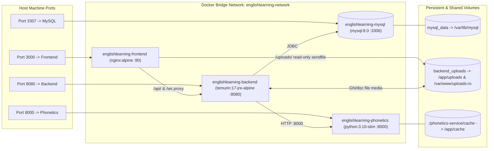

# 06. Bảo mật, Yêu cầu Phi chức năng, Triển khai, Kiểm thử & Quản trị Rủi ro

> Tài liệu này đặc tả kiến trúc bảo mật theo mô hình **STRIDE Threat Model**, các chỉ số **NFR/SLO**, mô hình triển khai (**Docker / Local / Hybrid**), chiến lược kiểm thử đa tầng và **Sổ đăng ký Nợ kỹ thuật & Rủi ro Production (Technical Debt & Risk Register)** dựa trên kiểm toán trực tiếp mã nguồn hiện tại.

---

## 1. Thiết kế Bảo mật & STRIDE Threat Model

### 1.1. Các Lớp Phòng thủ Hiện hành (Defense-in-Depth)

1. **Xác thực & Phiên Stateless (`SecurityConfig`, `JwtServiceImpl`, `RefreshTokenServiceImpl`):**
   - Tắt session HTTP (`SessionCreationPolicy.STATELESS`) và CSRF cookie truyền thống; mọi yêu cầu API đi qua `JwtAuthenticationFilter` trích xuất Bearer JWT ký HMAC-SHA (`Decoders.BASE64` secret từ `secrets.properties`).
   - **Access Token TTL:** `30 phút` (`1,800,000 ms` trong `AppProperties.Jwt`).
   - **Refresh Token Rotation:** Lưu bản ghi UUID kép trong bảng `refresh_tokens`, trả về client qua cookie `HttpOnly`, `SameSite=Strict`, `Path=/api/v1/auth`. Mỗi lần đăng nhập hoặc làm mới, hệ thống xóa token cũ của user (`deleteByUser`), đảm bảo tối đa 1 phiên refresh chủ động.
   - **Chính sách Đóng Tự đăng ký:** `POST /api/v1/auth/register` chủ động ném `ForbiddenException` (`403`); tài khoản mới chỉ được tạo bởi Admin qua `POST /api/v1/admin/users` (mật khẩu băm `BCryptPasswordEncoder`).
2. **Phân quyền RBAC Đa tầng (`@EnableMethodSecurity`):**
   - Lớp UI: `ProtectedRoute` kiểm tra `isAuthenticated` và `allowedRoles`.
   - Lớp API: `@PreAuthorize("hasRole(...)")` và `@PreAuthorize("hasAnyRole(...)")` trên từng Controller/Method.
   - Lớp Dữ liệu: Kiểm tra quyền sở hữu/ghi danh lớp học trước khi trả bài tập, lộ trình ngày (`DailyStudyPlanServiceImpl`), nộp bài thi (`SubmissionServiceImpl`) hoặc sửa audio (`ExerciseAudioServiceImpl`).
3. **Bảo mật WebSocket (`WebSocketConfig`):**
   - `ChannelInterceptor` xác thực JWT ngay tại frame `STOMP CONNECT`, gán `Principal.name = userId.toString()` để định tuyến chính xác tới `/user/{userId}/queue/notifications`.
4. **Kiểm toán Bất biến (`AuditLogAspect`):**
   - Ghi nhận tự động IP (`X-Forwarded-For` / `RemoteAddr`), `user_id`, `action` (`CREATE`, `UPDATE`, `DELETE`, `ASSIGN`, `ENROLL`), `entityName`, `metadataJson` vào bảng `audit_logs` (chỉ tạo mới, không có endpoint sửa/xóa).
5. **Kiểm soát File Upload & Path Traversal:**
   - Giới hạn Tomcat/Spring multipart tối đa `500MB` (video), avatar tối đa `5MB` (chỉ nhận `image/*`), audio `phonetics-service` tối đa `15MB`, độ dài essay `writing-scorer` tối đa `30,000` ký tự.
   - `VideoController.serveHlsFile()` kiểm tra chặn `..`, `/`, `\` và xác minh `filePath.startsWith(hlsDir)` chống Path Traversal.

### 1.2. Ma trận Mô hình hóa Mối đe dọa (STRIDE Threat Model)

| Nhóm đe dọa (STRIDE) | Kịch bản tấn công tiêu biểu | Biện pháp kiểm soát hiện có | Khoảng trống cần khắc phục (Xem mục 5) |
| :--- | :--- | :--- | :--- |
| **Spoofing** (Giả mạo danh tính) | Đánh cắp Access/Refresh Token; giả mạo user trên WebSocket STOMP | Cookie `HttpOnly` + `SameSite=Strict`; Refresh Token Rotation; STOMP `CONNECT` JWT verification | Cookie đang đặt `secure(false)` (rủi ro qua HTTP thường); `/ws/audio` chưa qua JWT handshake filter |
| **Tampering** (Sửa đổi dữ liệu) | Gian lận điểm/thời gian thi CBT; sửa request gửi AI | Server tính điểm từ DB (`GradingEngineServiceImpl`), kiểm tra `startedAt` + `timeLimitMinutes`, ghi log vi phạm proctoring | Chưa ký integrity payload câu trả lời; khóa kiểm tra CORS đang quá mở (`*`) |
| **Repudiation** (Chối bỏ hành động) | Admin/Teacher xóa lớp, sửa điểm hoặc xóa dữ liệu rồi phủ nhận | `AuditLogAspect` + `auditService.recordAuditLog` trong `AdminDatabaseServiceImpl` | Điểm nối AOP `service.*` cần cập nhật chắc chắn cho `service.impl.*` |
| **Information Disclosure** (Rò rỉ thông tin) | Lộ stack trace/cấu trúc nội bộ khi lỗi 500; xem trộm video HLS lớp khác | `phonetics-service` & `writing-scorer` ẩn stack trace; `User.password` gắn `WRITE_ONLY` | `GlobalExceptionHandler` trả `ex.getMessage()` cho lỗi 500; `/api/v1/videos/*/hls/**` và `/raw` đang `permitAll()` |
| **Denial of Service** (Từ chối dịch vụ) | Spam gọi API AI đốt tiền Gemini/Groq; upload video/audio khổng lồ làm tràn RAM/đĩa | `PESSIMISTIC_WRITE` quota (20/ngày); Sliding Window (3/phút Student, 5/phút Teacher); Kill Switch; xóa file tạm sau transcode | Sliding window & Kill Switch nằm in-memory (`ConcurrentHashMap`), mất đồng bộ nếu chạy >1 instance |
| **Elevation of Privilege** (Leo thang đặc quyền) | Student gọi API Teacher/Admin hoặc repair audio lớp khác | `@PreAuthorize` trên toàn bộ endpoints; kiểm tra `existsByClassroomIdAndStudentId` | Thiếu test tự động quét mọi endpoint mới đảm bảo không quên `@PreAuthorize` |

---

## 2. Yêu cầu Phi chức năng (NFRs), SLIs & SLOs

| Nhóm chất lượng | Chỉ số đo lường (SLI) | Mục tiêu thiết kế (SLO / Target) | Cơ chế đảm bảo trong mã nguồn |
| :--- | :--- | :--- | :--- |
| **Hiệu năng AI (Latency)** | P95 thời gian chấm `phonetics-service` (Tầng 1) | `<= 1.0 – 1.5s` (câu ngắn trên CPU/GPU) | Nạp sẵn model Wav2Vec2 + Kokoro khi startup; chạy single-pass CTC emission |
| **Hiệu năng AI Writing** | P95 thời gian chấm `writing-scorer` | `<= 1.5s` (GPU) / `<= 5s` (CPU), timeout `30s` | `DeBERTa-v3-small` (`max_length=512`), `infer_lock` threadpool |
| **Độ sẵn sàng AI (Availability)** | Tỷ lệ yêu cầu chấm Nói/Viết có phản hồi hợp lệ | `>= 99.5%` | Kiến trúc 3-Tier AI Fallback (Local Python -> Groq/Gemini -> Groq LLM) |
| **Chuyển đổi Video (Throughput)** | Thời gian phản hồi endpoint `POST /api/v1/videos` | `< 2.0s` sau khi upload xong file | Xử lý FFmpeg ABR bất đồng bộ qua RabbitMQ / `taskExecutor` |
| **Độ bền Dữ liệu Bài thi** | Tỷ lệ mất bài làm khi rớt mạng tạm thời | `0%` mất đáp án đã chọn | Auto-save nháp `localStorage` + đính kèm `currentAnswers` khi báo vi phạm |
| **Quản trị Kết nối DB** | Thời gian chờ lấy JDBC connection | `< 20s` (pool `10..30` connections) | HikariCP tuning + Batch query chống N+1 tại `DailyStudyPlanServiceImpl` |
| **Khả năng Bảo trì** | Tỷ lệ bao phủ kiểm thử tự động | `120+` test suites trên toàn Monorepo | `86` JUnit/Mockito + `24` Vitest + `13` Phonetics Pytest + `test_service.py` |

---

## 3. Kiến trúc Triển khai & Vận hành (Deployment & Infrastructure)

### 3.1. Topology Docker Compose Hiện tại (`docker-compose.yml`)

### 3.2. So sánh 3 Chế độ Vận hành (`README.md`)

| Tiêu chí | Chế độ Local Dev | Chế độ Docker Compose | Chế độ Hybrid (Khuyến nghị Dev) |
| :--- | :--- | :--- | :--- |
| **Frontend** | `npm run dev` (`localhost:5173`, Hot Reload) | Nginx container (`localhost:3000`) | `npm run dev` (`localhost:5173`) |
| **Backend** | `.\mvnw.cmd spring-boot:run` (`localhost:8080`) | `eclipse-temurin:17-jre-alpine` (`:8080`, non-root `appuser`) | `.\mvnw.cmd spring-boot:run` (`localhost:8080`) |
| **MySQL** | `localhost:3306` | `mysql:3306` nội bộ / `localhost:3307` từ host | Container `mysql` |
| **AI Services** | Uvicorn `:8000` (`phonetics-service`) & `:8001` (`writing-scorer`) | `phonetics-service:8000` (chưa khai báo `writing-scorer` trong compose) | Container `phonetics-service` + Local `writing-scorer` |

### 3.3. Quy trình Đóng gói Multi-Stage & Cấu hình Bí mật

- **Backend `Dockerfile`:** Stage 1 (`eclipse-temurin:17-jdk-alpine`) build JAR (`./mvnw clean package -DskipTests`); Stage 2 (`17-jre-alpine`) chạy dưới quyền user không phải root (`appuser:appgroup`).
- **Frontend `frontend/Dockerfile`:** Stage 1 (`node:20-alpine`) build Vite với `VITE_API_BASE_URL=""` (để Nginx reverse proxy đồng nhất nguồn); Stage 2 (`nginx:alpine`) chạy `nginx.conf` (Gzip level 5, cache 1 năm cho `/assets/`, `no-cache` cho `/index.html`).
- **Quản lý Bí mật:** Thông số nhạy cảm (DB credentials, JWT secret, Cloudflare R2 keys, Gemini & Groq API keys) được nạp qua `classpath:secrets.properties` (đã loại khỏi Git theo commit `9b43c7f`) và ánh xạ vào `AppProperties` (`@ConfigurationProperties(prefix = "app.secrets")`).

---

## 4. Chiến lược Kiểm thử & Đảm bảo Chất lượng (QA & Testing Pyramid)

| Tầng kiểm thử | Công cụ & Thư mục | Quy mô xác minh trong Repo | Phạm vi kiểm chứng chính |
| :--- | :--- | :--- | :--- |
| **Backend Unit & Slice Tests** | JUnit 5, Mockito, Spring Security Test (`src/test/java`) | **86 test classes** | `AuthServiceImpl`, `JwtService`, `ShadowingServiceImpl`, `AiLabServiceImpl`, `PythonIntegrationServiceImpl`, `AdminDatabaseServiceImpl`, `ClassroomReportExcelExporter`, `SubmissionServiceImpl`, `VideoServiceImpl`, `VideoTranscodeConsumer`, `R2StorageServiceImpl`, `GlobalExceptionHandler` |
| **Frontend Component & API Contract Tests** | Vitest `5.1.0`, Testing Library, jsdom (`frontend/src/**/__tests__`) | **24 test suites** | `axiosClient.test.ts` (401 queue & FormData refresh), `routesAndLayouts.test.tsx`, `stores.test.ts`, `apiContractIntegration.test.tsx`, `VideoPlayerRecovery.test.tsx`, `VideoModerationPage.test.tsx`, `assignmentImport.test.ts`, `studentShadowingAndSpeaking.test.tsx` |
| **Phonetics AI Tests** | Pytest, `pytest-asyncio`, httpx (`phonetics-service/tests/`) | **13 test suites** | VAD, Audio Quality Gate, Preprocessor, Trellis Aligner, Formant F1/F2, Confidence Estimator, Missing Words, Scorer, Kokoro TTS, API endpoints |
| **Writing Scorer Tests & Offline Eval** | Pytest (`writing-scorer/test_service.py`) & `evaluate.py` | End-to-end API + **Benchmark 876 mẫu** | Validation & Test QWK/MAE/RMSE trên `Jackrong/IELTS-writing-feedback-reasoning` & `chillies/IELTS-writing-task-2-evaluation` |

---

## 5. Sổ đăng ký Nợ kỹ thuật & Rủi ro Production (Technical Debt & Risk Register)

Để phục vụ đánh giá chuyên nghiệp và chuẩn bị đưa hệ thống lên môi trường Production thực tế, bảng dưới đây liệt kê trung thực các điểm yếu hiện hữu trong mã nguồn cần xử lý:

| Mã | Mức độ | Vấn đề hiện hữu & Bằng chứng mã nguồn | Tác động nếu đưa lên Production | Kế hoạch khắc phục (Remediation) |
| :--- | :---: | :--- | :--- | :--- |
| **RISK-01** | **P0** | `SecurityConfig.java` cấu hình `allowedOriginPatterns(List.of("*"))` kết hợp `allowCredentials(true)`; `AuthController.java` đặt cookie `secure(false)`. | Nguy cơ CSRF/CORS bypass và rò rỉ `refreshToken` qua kết nối không mã hóa HTTP. | Giới hạn `allowedOrigins` theo whitelist domain production; cấu hình `secure(true)` động theo profile HTTPS. |
| **RISK-02** | **P0** | `RefreshTokenServiceImpl.java` & `AuthController.java` dùng `@Value("${jwt.refresh-token-expiration-ms:60480000000}")` (khác key `app.secrets.jwt.refresh-token-expiration-ms` và mặc định **700 ngày** do dư một số `0`). | Nếu không set `jwt.refresh-token-expiration-ms` tường minh, Refresh Token có hiệu lực tới 700 ngày thay vì 7 ngày (`604800000` ms). | Chuẩn hóa đọc trực tiếp từ `appProperties.getJwt().getRefreshTokenExpirationMs()` (`604800000L`). |
| **RISK-03** | **P0** | `GlobalExceptionHandler.java` trả trực tiếp `ex.getMessage()` trong phản hồi `500 Internal Server Error`. | Có thể làm lộ thông tin schema SQL hoặc chi tiết nội bộ hệ thống tới client. | Log chi tiết server-side theo `traceId`, trả thông báo lỗi tổng quát an toàn ra client. |
| **RISK-04** | **P0** | `SecurityConfig.java` đặt `permitAll()` cho `/api/v1/videos/*/raw`, `/api/v1/videos/*/hls/**` và `/ws/**` (bao gồm `/ws/audio`). | Người chưa đăng nhập hoặc chưa ghi danh lớp có thể truy cập trực tiếp video qua UUID hoặc gửi audio tới `/ws/audio`. | Sử dụng Signed URL / Short-lived Media Token cho HLS & yêu cầu xác thực JWT khi nâng cấp kết nối `/ws/audio`. |
| **RISK-05** | **P1** | `application.properties` bật `spring.jpa.hibernate.ddl-auto=update` và `spring.flyway.enabled=false`. | Rủi ro lệch schema hoặc khóa bảng khi nâng cấp phiên bản CSDL production. | Chốt baseline SQL migration với Flyway (`V1__init.sql`), chuyển Hibernate sang `validate`. |
| **RISK-06** | **P1** | `AiMonitoringServiceImpl.java` lưu `globalKillSwitch`, `rateLimiterMap`, `teacherBlockedMap`, `teacherCustomLimits` bằng `ConcurrentHashMap` trong RAM. | Mất trạng thái khi restart server và không đồng nhất nếu chạy nhiều backend replica. | Di chuyển bộ đếm Sliding Window, Kill Switch và Teacher Quota sang **Redis** (`StringRedisTemplate` + Lua script / Bucket4j). |
| **RISK-07** | **P1** | `docker-compose.yml` mới định nghĩa 4 container (`mysql`, `phonetics-service`, `backend`, `frontend`); chưa có container cho `redis`, `rabbitmq`, `writing-scorer` và FFmpeg trong backend image. | Chạy Docker thuần hiện tại sẽ kích hoạt chế độ fallback (async executor thay RabbitMQ, raw video thay FFmpeg HLS, Cloud LLM thay `writing-scorer`). | Bổ sung service `redis`, `rabbitmq`, `writing-scorer` vào `docker-compose.yml` và cài `ffmpeg` trong `Dockerfile` backend. |
| **RISK-08** | **P1** | Chưa đồng nhất tiền tố `/api/v1` cho `classroom` (`/api/{role}/classrooms`) và `curriculum` (`/api/curriculum`); bảng `student_vocabulary_progress` đã có schema SM-2 nhưng chưa mở API review SM-2. | Phân mảnh quy ước API; tính năng ôn tập ngắt quãng SM-2 chưa sử dụng hết thiết kế CSDL. | Hỗ trợ alias `/api/v1/*` để chuyển đổi mượt mà và bổ sung `SrsController`/`SrsService`. |
| **RISK-09** | **P2** | Pointcut của `AuditLogAspect` là `execution(* com.englishlearning.*.service.*.create*(..))` và `AiMonitoringServiceImpl` hiển thị nhãn `"Groq LLaMA 3.3 70B Versatile"` trong khi `AppProperties` cấu hình `openai/gpt-oss-120b`. | Nguy cơ bỏ sót audit log trên một số service impl mới và sai lệch tên mô hình hiển thị trên báo cáo FinOps. | Đổi pointcut thành `service..*.*(..)` kèm test xác minh AOP; lấy động `appProperties.getGroq().getChatModel()` làm nhãn thống kê. |
